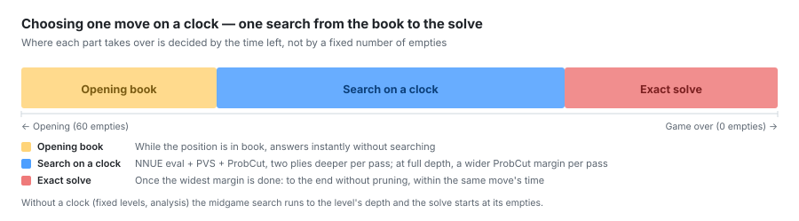
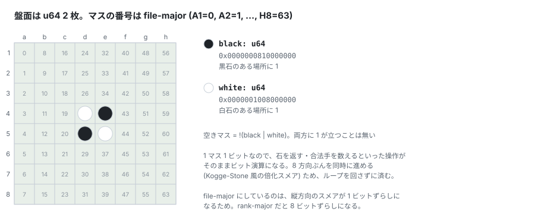
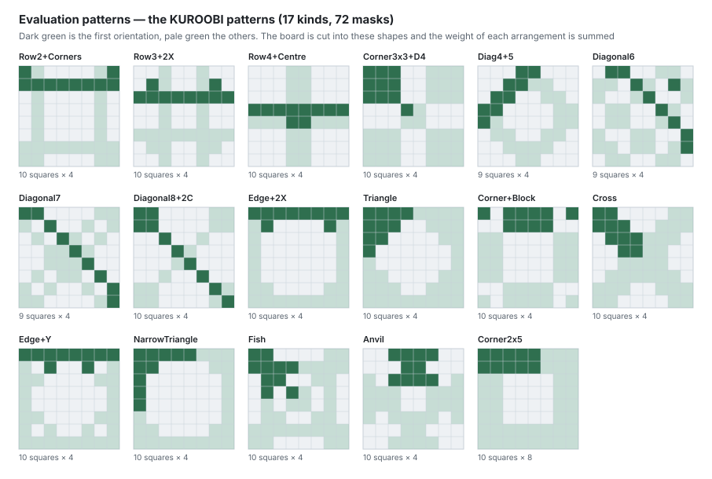

# KUROOBI (黒帯)

*[English version](README.md)*

**2×u64 ビットボードによるリバーシ (オセロ) エンジン。** Rust 実装で、エンジン本体は
外部依存なし (`libc` は学習ツールのシグナル処理用、GPU 学習は任意、乱数と
ベンチマークは開発時のみ)。探索は NNUE 評価 + ProbCut、終盤は完全読み。
対局・検討・定石閲覧の GUI と、オンライン対戦サーバ (GGS) への接続を同梱している。

> 「オセロ」は株式会社メガハウスの登録商標。

| | |
|---|---|
| **実装** | Rust。エンジン本体に外部クレート依存なし |
| **GUI** | Tauri + TypeScript。対局・検討・定石・GGS 接続 |

---

## 画面

左の並びが行き先。**対局・検討・定石**と、GGS に接続すると開く 7 つの画面。
狭くすると右の枠 → 左の文字 → 上の補助情報の順に畳み、盤を最後まで残す。

### 対局


KUROOBI の受け持ちを選んで始める (盤を押しても始まる)。右の枠は**上に強さ、
下に棋譜**。KUROOBI はレベル (深さと読み切りが決まった強さ) か持ち時間で打ち、
持ち時間のときは対局中だけ両者の時計が動く。棋譜に手が入ったら新規対局まで
選び直せず、持ち時間の対局では残り時間がその場所に出る。棋譜には **1 手ごとの
評価値・思考時間・その手がどこから来たか (定石 / 定石·学 / 探索 / 読切)** が
並び、悪手には下げ幅つきの ▼ が付く。

待ったは自分の前回の手の前まで戻し、間の KUROOBI の手とパスも一緒に戻る。
時計も戻る。画面を離れると対局は一時停止し、棋譜の過去の手を押すとそこで
止まり、そこから打てばその手から対局が続く。

### 検討


**盤のマスに全合法手の評価値**が出て、深め続けるので見ているあいだ値が
締まっていく。マスの下には「定石 / 読切 / N 手」と出どころが付く。解析の強さは
右の枠で、対局の強さとは別に決める。

盤の下は手数を辿る帯で、**敗着の赤い印**が入る。その下の評価値グラフは
「分析」で棋譜を通して測り直したもので、どこで形勢が動いたかが 1 本の線で
分かる。途中の局面で棋譜と違う手を打つときは、先の棋譜が消える前に確かめる。

### 定石


定石を局面から辿る。盤のマスに候補手の値が出て、左の木は枝を字下げで並べ、
手ごとの値と採用局数を添える。**実戦から学習した手**には金の「学習」が付く。
右の枠にはその局面の値と出所が出る。

終局した対局は定石に書き戻される (設定 → エンジン)。取り込んだ対局の控えは
「学習ログ」タブにあり、**対局 → 敗着 → 書き換えた手 (旧→新)** まで辿れる。
おかしな対局を取り込んでしまったら対局単位で取り消せる。

### オンライン対戦 (GGS)


対局・観戦・ロビー・プレイヤー・結果・チャット・大会・生の通信を見る
コンソールを内蔵し、自動対局は申し込みのシートから同じ相手に申し込み続ける。
同期対局 (同じ開局を先後入れ替えて 2 局) は 2 面を並べ、KUROOBI から見た
評価値のグラフ 1 本に各手の思考時間を棒で添える。終わった対局はレートの推移と
一緒に残り、プレイヤーや対局の詳細は右から引き出しで開く。

サーバーの実装を読んで決めた振る舞い (中断対局を自動で再開しない、
ロスタイムを時計の跳ね上がりで検出する、レートのプールは 2 つだけ) は
[GUI](docs/gui.md#what-ggs-taught-us) にまとめてある。

---

## 仕組み

### 1 手を決めるまで



対局の進み具合で受け持ちが変わる。**定石にあり、かつその局面の全合法手を
調べてある間は探索しない**。棋譜に現れた手だけを評価したエントリは「標本の
中の 1 位」でしかないので手掛かり扱いにし、探索は行って定石の手を並べ替えの
先頭に置く。

持ち時間のある対局では、定石を抜けたあと 1 本の探索が全部の手を指す。1 回の
反復で 2 手ずつ深め、深さが終局に届いたら同じ深さを ProbCut の幅を 1 段ずつ
広げて読み直し、いちばん広い幅を終えたら刈らずに読み切って厳密な石差を返す。
持ち時間のない対局 (Lv 指定・解析) では、中盤探索が Lv の深さまで読み、Lv の
空き数から読み切る。

### 持ち時間だけで配分を決める

1 手ごとに残り時間の一部を配る。盤が埋まるほど多めに配る。

    予算 = 1.8 × (残り時間 − 2 秒) ÷ max(4.8, 37 − 石数)

新しい反復は予算の内でしか始めず、予算の半分を過ぎたら、直前の反復で最善手が
変わったか fail low したときだけ続ける。期限で切れた反復は捨て、その前の反復の
手を指す。読み切りは最後の反復にすぎないので同じ予算で走り、切れたら直前の
全深さの手が残る。機械ごとに測るものはない — 遅い機械は同じ時間で浅くなる
だけ。詳しくは [探索](docs/search.md#search-on-a-clock-clockrs)。

### 盤面はビット演算で動く



石返しも合法手生成も、ループを回さず 8 方向を同時に進める。詳しくは
[盤面表現とビット演算](docs/board.md)。

### 評価はマスの組を索く



盤面を **17 種類のマスの組 (パターン)、向きを含めて 72 個**に切り、それぞれの
並びに対応する重みを足し合わせる。これを **KUROOBI パターン**と呼ぶ。9〜10 マスの
16 種をそれぞれ 4 向き (横一列の 2〜4 段目と隅の 3x3 は 10 マス、斜め・辺・隅の形)、
隅の 2x5 を 8 向きで持つ。上の図の濃い緑が 1 つ目の向き、淡い緑が残りの向き。

着手のたびに全部を数え直すのではなく、**変化したマスを含むパターンだけ**を
更新する (差分パターンインデックス)。

いまの対局用評価は専用の 32 個のマスの組を入力に取る NNUE で、整数に量子化
して NEON で動く。KUROOBI パターンは終盤ソルバの手の並べ替えと、warm-up の最初の見積もりに使う。詳しくは [評価関数](docs/eval.md)。

---

## ドキュメント

| | 中身 |
|---|---|
| [盤面表現とビット演算](docs/board.md) | 2×u64 の持ち方、石返し、合法手生成、局面ハッシュ、確定石 |
| [評価関数](docs/eval.md) | パターン評価、差分インデックス、NNUE (構造・整数推論・幅) |
| [探索](docs/search.md) | 持ち時間の探索、中盤探索 (PVS・ProbCut・並列化)、終盤完全読み、置換表 |
| [学習](docs/learning.md) | 学習データ、線形と NNUE の学習、GPU のステップ |
| [到達水準](docs/benchmarks.md) | 対局成績、FFO ベンチマーク、並列化の計測、棄却した施策 |
| [CLI ツール](docs/cli.md) | 学習・モデルの組み立て・定石生成・対戦のコマンド |
| [GUI](docs/gui.md) | 対局・検討・定石・GGS、実戦からの定石学習 |

個々の施策の採否は原則すべて実測に基づいており、**計測して効果がなかった
ものは採用していない**。棄却した施策も棄却理由ごと記録してある。

---

## リポジトリ構成

```text
src/
├── lib.rs             クレートルート (公開 API の再輸出)
├── board.rs           盤面型 Board (2×u64 + 手番 + 空きマス数)
├── position.rs        座標型 (A1..H8 ⇄ ビット index)
├── color.rs           手番 (Black/White)
├── game.rs            対局進行・履歴・棋譜 (KIFU)
├── bitboard.rs        石返し・合法手生成のビット演算
├── zobrist.rs         局面ハッシュ (CRC32C)
├── pattern.rs         評価パターン定義 (2 セット)
├── pattern_index.rs   差分パターンインデックス
├── linear.rs          線形パターン評価 + 教師あり学習
├── nnue.rs            NNUE 評価関数 (i16 の表 + i8 の層、NEON)
├── record.rs          学習レコード形式
├── wthor.rs           WTHOR 棋譜書庫 (.wtb) の読み取り
├── clock.rs           持ち時間のある対局の探索 (時間の配り方を含む)
├── midgame.rs         Lv 指定・解析用の NNUE 中盤探索: YBWC + Lazy SMP
├── solver.rs          終盤完全読みソルバ
├── stability.rs       確定石
├── book.rs            定石 (8 対称正規化・許容幅つき乱択)
├── learn.rs           実戦の帰結を定石へ書き戻す学習 (負け局の回避)
├── resources.rs       重み・定石の在り処 (設定ファイルで指定できる)
├── engine.rs          GUI と CLI が共用するセッション層 (着手選択・解析)
├── trainer.rs         学習データ入出力・対称形・エポック統計
└── bin/               CLI ツール群 (学習・stage 合成・MPC 較正・定石生成・GTP サーバ・GGS クライアント)
gui/                   GUI (Tauri + Vite/TypeScript)
docs/                  実装の解説 (この README から辿る)
tests/                 perft 網羅・ソルバ統合テスト・停止までの時間
benches/               マイクロベンチ (criterion)
problems/              ソルバのベンチマークと σ 較正の基準局面 (OBF)
.github/workflows/     CI (書式・clippy・テスト・GUI ビルド)
CLAUDE.md              作業の手順と決まりごと
weights/ logs/ train_data/   学習済み重み・ログ・教師データ (git 管理外)
```

---

## 開発

```sh
cargo fmt --all
cargo clippy --all-targets -- -D warnings
cargo test --release
```

GUI は `gui/` で `npm run build` → `cargo build --release` の順に回す
(Tauri はフロントをバイナリに埋め込むため、逆順だと変更が反映されない)。

テストは perft による着手生成の網羅検証、差分パターンインデックスの全再計算
との一致、確定石の対局不変性 (プロパティテスト)、探索の値等価性 (参照
negamax との一致)、停止を立ててから探索が抜けるまでの時間などを含む。

**値の一致だけでは足りない。** 並列探索が「正しい値」と「誤った手」を返す
欠陥は、厳密解のテストも FFO も全部通り抜けて実戦で 36 石を失った。見つけたのは
値の比較ではなく、返した手を実際に指して確かめる検証だった (打ち切りは
実戦では数千手に 1 回しか起きないので、`SOLVER_CHAOS` でわざと濃く起こす)。
詳しくは [探索](docs/search.md#parallel-search-correctness)。

CI は push と pull request で、エンジン (書式・clippy・テスト・feature 別
ビルド) と対局 GUI (型検査・フロントのビルド・アプリのビルド) を回す。

学習済みの重みは容量の都合で git に入れていないため、それを要するテストと
棋力の測定は CI では走らせない。手元で行う。

作業の手順と決まりごとは [CLAUDE.md](CLAUDE.md) にまとめてある。

---

## ライセンス

MIT ([LICENSE](LICENSE))
