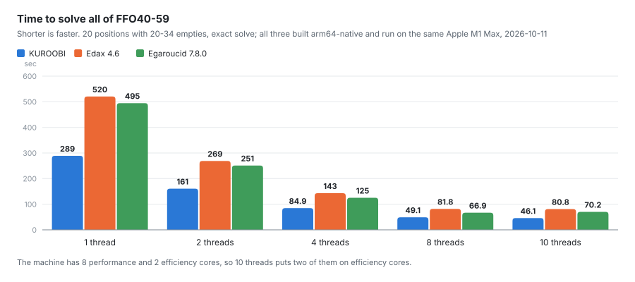

# Level reached

Game results, the FFO benchmark, and parallelism measurements. Measures
that were not adopted are kept here too, each with the reason it was
rejected.

> **The drivers named below are no longer in `src/bin`.** `solve_obf`,
> `roundrobin`, `arena`, `lab` and `microbench` were moved out on
> 2026-09-14. Everything here is a record of what they measured, with the
> flags and conditions they were given; none of it can be re-run as
> written without restoring them from `c89d9ba^` first.
> The exception is the [FFO benchmark](#ffo-benchmark-endgame-exact-solve)
> and the thread-count table, re-measured on 2026-10-11 against freshly
> built opponents.

## Level reached

Games are against Edax 4.5.5 (on macOS, the x86 binary through Rosetta,
at fixed levels, so its speed does not enter the result); the endgame
benchmark is against Edax 4.6 and Egaroucid 7.8.0, both built natively
for arm64.

### Games against Edax

| Conditions | Opponent | Result |
|---|---|---|
| depth10 + solve22 (no MPC) | level 11 | 46.5% (even) |
| depth14 + solve22 + MPC | level 11 | **57.8%** (400 games, significant) |
| depth16 + solve22 + MPC | level 13 | **53.9%** (800 games, significant) |
| depth22 + exact solve from 27 empties + MPC, 8 threads | level 24 | 49.0% (100 games, even) |

The last row is set up so that both sides balance at around 0.5 seconds
per move.

The quality of the evaluation function on its own has also been confirmed
to be statistically equal to the official Edax evaluation (51.7%) in a
comparison over 2200 games with the search conditions matched.

### Round robin (comparing evaluation functions)

To compare **evaluation functions** rather than how well the search is
built, every engine was set to a plain fixed 8-ply search and played a
round robin. At 8 plies, positions with 8 or fewer empties are read
straight through to the end of the game, so no separate endgame setting is
needed. No opening book, no selective pruning, single-threaded. The
opening 6 moves are played at random and each pair plays 2 games with the
colours swapped, so every pair contests the same position from both sides.
100 games per pair, 600 in total.

| Rank | Engine | Points | Win rate |
|---|---|---:|---:|
| 1 | Egaroucid 7.8 | 196.0 / 300 | **65.3%** |
| 2 | **KUROOBI** | 155.5 / 300 | **51.8%** |
| 3 | Edax 4.6 | 141.5 / 300 | 47.2% |
| 4 | Zebra (the WZebra thinking engine) | 107.0 / 300 | 35.7% |

Head-to-head results (wins-losses-draws as seen from the row):

| | KUROOBI | Edax | Zebra | Egaroucid |
|---|---|---|---|---|
| **KUROOBI** | — | 52-43-5 (54.5%) | 56-39-5 (58.5%) | 41-56-3 (42.5%) |
| **Edax** | 43-52-5 | — | 57-36-7 (60.5%) | 33-62-5 (35.5%) |
| **Zebra** | 39-56-5 | 36-57-7 | — | 25-73-2 (26.0%) |
| **Egaroucid** | 56-41-3 | 62-33-5 | 73-25-2 | — |

We come out ahead of Edax and Zebra and fall short of Egaroucid. But
54.5% over 100 games is within the "even to slightly ahead" band; there
are not enough games to call it a clear difference. Comparing our 42.5%
against Egaroucid with Edax's 35.5% and Zebra's 26.0%, we sit between
Egaroucid and Edax.

**Only Edax needed work to match the conditions.** Its level table ties
the midgame depth to the point where the exact endgame solve starts, so
`-l 8` becomes "8-ply search + exact solve from 16 empties", which makes
only its endgame deeper than the other engines (`-depth` is for solve and
has no effect in games). So an `EDAX_FIXED_DEPTH` environment variable was
added to Edax; when it is set, the level table is filled with the plain
fixed depth. The default behaviour is unchanged.

On building the opponents:

* **Zebra** is the WZebra thinking engine (srczebra) ported to arm64
  macOS. 5 things were needed — disabling `regparm`, the name clash
  between the static variable `wait` and `wait(2)`, `dir.h` (DOS only)
  replaced by `unistd.h`, `rdtsc` replaced by `cntvct_el0`, and the
  `windows.h` path routed to POSIX through `CRON_SUPPORTED`. On top of
  that there was no interface returning "the best move in this position",
  so a `main` for the engine was written. The evaluation coefficients and
  the opening book ship with the source, so it plays on the same data as
  WZebra.
* **Egaroucid** officially has ARM options and builds unmodified with
  `-DHAS_ARM_PROCESSOR=ON -DHAS_NO_AVX2=ON`. It speaks GTP as standard, so
  it connects as is.

### NNUE fine-tuning — part of the MSE drop turns into strength and part does not

Running a converged NNUE again at a low learning rate still lowers the val
MSE. **How far it has to drop before it becomes strength** was measured
over 2 generations by direct head-to-head play between old and new
(depth 6, no opening book, 6 random opening moves, colours swapped).

| Generation | val MSE | Opponent | Games | Win rate (95% CI) | Disc difference | Verdict |
|---|---:|---|---:|---|---:|---|
| Generation 2 | 32.64 → **31.94** | previously shipped | 1600 | **53.5%** (51.1..56.0) | +1.47 | adopted |
| Generation 3 | 31.94 → **31.74** | generation 2 | 1600 | 50.1% (47.6..52.5) | +0.16 | adopted |
| Generation 4 | 31.74 → **31.05** | generation 3 | 1596 | 52.3% (49.9..54.8) | +0.79 | adopted |

The 0.70 improvement of generation 2 became +1.47 discs, but the 0.20 that
followed was 0 discs. **There is a point past which a better fit stops
being converted into a difference in the moves played.**

**Generation 3 was adopted because it merely fails to raise strength — it
does not lower it either.** It is a dead heat with the CI already narrowed
to ±2.5pt, so there is little room for a hidden regression. The lower MSE
certainly fits the training data better, and since it does not hurt
strength there is no reason not to take it.

**This is outside the scope of "do not keep what has no effect"
(CLAUDE.md rule 1).** Rule 1 is for **measures that add complexity or
runtime cost**; if such a measure has no effect, what it added is pure
loss. Swapping a weight file adds neither, so what goes on the scales is
different.

**Generation 4 was obtained purely by lowering lr all the way.** It was
not learning, it was **removing the SGD noise**. The rates are chained
1e-6 → 3e-7 → 1e-7 → 3e-8 → 1e-8 → 3e-9, each rung cut off after 1-2
epochs (at every lr, epoch 1 or 2 is the best and it always gets worse
afterwards). The improvements were **−0.519 → −0.126 → −0.038 → −0.013**,
roughly 1/3 each time, and extrapolating the geometric series gives **a
limit of 31.04**.

There are 2 grounds for saying "noise, not learning".

* **The lower the lr, the monotonically better.** 5e-5 is worse than the
  starting value, and 1e-6, 1e-7, 1e-8 get better as they go down. If
  learning were progressing, the best lr would be somewhere in the middle
* **Increasing the data per epoch makes it worse.** At the same lr,
  260M/epoch gives 31.09 and 750M/epoch gives 31.15. What works is not the
  amount of learning but the **total distance travelled** (lr × number of
  updates), and less is better

In other words **the model was already sitting at the optimum and SGD was
merely wandering around it with a radius proportional to lr**. The shipped
weights were only one point in that cloud, and squeezing lr pulled them
toward the centre. This is the floor that plain SGD can reach with H=16.

Things learned as a by-product:

* **400 games are not enough.** Generation 2 gave 54.2% (49.4..59.1) over
  400 games, with no significant difference. The point estimate of the win
  rate was almost the same; only the CI was wide. To measure an
  improvement below 1 MSE, plan on 1600 games from the start
* **Fine-tuning a converged model requires picking the best epoch.** At
  every lr, epoch 1 or 2 is the best and it degrades monotonically
  afterwards. Running a predetermined number of epochs and taking the
  final weights always loses
* **Re-symmetrise the output of fine-tuning.** Training looks at the error
  averaged over the 8 symmetric forms, but the weights themselves do not
  stay symmetric. Symmetrising also lowers the MSE slightly (31.99 →
  31.94)
* A sequential match driver needs about 7 hours for 1600 games. Split into
  8 processes with different seeds it takes just under 2 hours

### FFO benchmark (endgame exact solve)

Measured on 2026-10-11 against Edax 4.6 and Egaroucid 7.8.0. **All three
were built natively for arm64 and run one at a time on the same
machine, on the same problem files, at 100% (exact) solve.** Every
engine returns the same value on every problem.

**Measurement conditions** (stated for reproduction and comparison):

| Item | Detail |
|---|---|
| CPU / RAM | Apple M1 Max (8 performance + 2 efficiency = 10 cores) / 64 GB |
| OS | macOS 26.5.1 |
| KUROOBI | `466154d`, Rust 1.98.1, `cargo build --release` (no PGO). Main table 2^25 entries (1.07 GB), cleared for every problem with the clear left out of the time |
| Edax | 4.6, `abulmo/edax-reversi` at `14f048c`, built as its README says: `make pgo-build ARCH=armv8.5-a COMP=clang OS=osx` (Apple clang 21). Run as `-solve <obf> -level 60 -n <threads> -h 26` (1.87 GB resident) |
| Egaroucid | 7.8.0 for Console, `ff9ec32`, the "macOS ARM64 Generic (Clang)" build. Run as `-l 60 -nobook -t <threads> -solve <obf>` with its default table (1.61 GB resident) |
| Runs | FFO40-59 at 1 and 8 threads twice and FFO1-39 three times, taking the minimum; the other thread counts and FFO60-79 once. The engines alternated within a round on 2026-10-11; our rows were run again alone on 2026-10-12 after the solver changed, more often than the others (every run is listed below) because the first pass that day ran slow |

Our driver is not in the tree: it is a loop around
`Solver::solve_with_eval` that clears the tables before each problem.
Edax needs `-level 60`, without which it runs an 87% selective search,
and its problem lines must be exactly 65 characters (board, space, side
to move); a trailing `;` makes it silently re-solve the previous board.

The machine was not otherwise idle (an editor and other sessions were
open), and thermal state moves these times by a few percent, so the
spread between two runs of the same thing is shown beside the totals.
**Node counts are not comparable between engines** — each counts
ordering and table probes differently — so the tables rank by time and
give nodes only for reference.

#### Totals

| Set | Threads | KUROOBI | Edax 4.6 | Egaroucid 7.8.0 | Edax / KUROOBI | Egaroucid / KUROOBI |
|---|---:|---:|---:|---:|---:|---:|
| FFO1-19 (14-16 empties) | 1 | 0.034 s | 0.048 s | 0.049 s | 1.41 | 1.44 |
| FFO1-19 (14-16 empties) | 8 | 0.031 s | 0.049 s | 0.050 s | 1.58 | 1.61 |
| FFO20-39 (6-22 empties) | 1 | 1.74 s | 2.28 s | 2.34 s | 1.31 | 1.34 |
| FFO20-39 (6-22 empties) | 8 | 0.524 s | 0.756 s | 0.704 s | 1.44 | 1.34 |
| **FFO40-59 (20-34 empties)** | 1 | 282.6 s | 520.4 s | 494.6 s | 1.84 | 1.75 |
| **FFO40-59 (20-34 empties)** | 8 | 43.2 s | 81.8 s | 66.9 s | 1.90 | 1.55 |
| **FFO60-79 (24-36 empties)** | 8 | 1582.9 s | 2649.6 s | 3173.3 s | 1.67 | 2.00 |

Every run behind those minimums, in seconds:

| Set | Threads | KUROOBI | Edax 4.6 | Egaroucid 7.8.0 |
|---|---:|---|---|---|
| FFO1-19 | 1 | 0.035, 0.038, 0.034 | 0.048, 0.049, 0.048 | 0.050, 0.050, 0.049 |
| FFO1-19 | 8 | 0.032, 0.031, 0.032 | 0.049, 0.049, 0.049 | 0.050, 0.051, 0.051 |
| FFO20-39 | 1 | 1.83, 1.87, 1.96, 1.77, 1.76, 1.74 | 2.28, 2.28, 2.28 | 2.34, 2.35, 2.35 |
| FFO20-39 | 8 | 0.551, 0.558, 0.569, 0.531, 0.529, 0.524 | 0.758, 0.756, 0.778 | 0.733, 0.721, 0.704 |
| FFO40-59 | 1 | 286.0, 285.5, 282.6, 283.6 | 520.4, 521.7 | 494.6, 495.9 |
| FFO40-59 | 2 | 148.8, 146.5 | 268.9 | 250.9 |
| FFO40-59 | 4 | 78.63, 77.62 | 143.2 | 125.3 |
| FFO40-59 | 8 | 44.21, 43.86, 43.16, 43.48 | 85.14, 81.80 | 70.87, 66.94 |
| FFO40-59 | 10 | 44.91, 41.24, 41.80 | 80.83 | 70.24 |
| FFO60-79 | 8 | 1637.7, 1582.9 | 2649.6 | 3173.3 |

On FFO40-59 **we are 1.84x faster than Edax and 1.75x
faster than Egaroucid on one thread, and 1.90x and 1.55x
on eight.** The whole of the one-thread lead is tree size: we search
9.34G nodes where Edax counts 25.39G and Egaroucid
14.87G (the definitions differ, so read those as a rough guide),
while Edax's nodes are the cheaper ones. From 1 to 8 threads we speed up
6.5x, Edax 6.4x and Egaroucid 7.4x, so only the gap to Egaroucid narrows
as threads are added.

**FFO60-79 is the set that still takes real time** — 26 minutes
for us on eight threads, 44 for Edax and 53 for Egaroucid — and
the order of the other two swaps there: Edax is ahead of Egaroucid on
the deepest problems. It was run on eight threads only; one thread
would take each engine several hours.

Edax's table size does not move this: at `-h 24`, a quarter of the table, FFO40-59 takes 515.0 s on 1 thread and 80.8 s on 8, against 520.4 s and 81.8 s at `-h 26`.

The shallow sets finish in milliseconds per problem and mostly measure
start-up; they are listed for completeness. Our figures exclude the
per-problem table clear, which neither of the others pays inside its
timing (Edax only bumps a date counter, Egaroucid initialises outside
the timed region).

#### Per-problem detail

**FFO40-59, 1 thread** (the fastest time on each row in bold):

| FFO | Emp | Value | KUROOBI s | Edax 4.6 s | Egaroucid 7.8.0 s | KUROOBI nodes | Edax 4.6 nodes | Egaroucid 7.8.0 nodes |
|---:|---:|---:|---:|---:|---:|---:|---:|---:|
| 40 | 20 | +38 | **0.144** | 0.214 | 0.198 | 5,941,982 | 10,871,279 | 9,431,517 |
| 41 | 22 | +0 | **0.248** | 0.441 | 0.306 | 10,460,280 | 23,776,974 | 10,892,492 |
| 42 | 22 | +6 | **0.370** | 0.538 | 0.377 | 16,555,809 | 26,627,982 | 15,464,004 |
| 43 | 23 | -12 | **1.083** | 1.700 | 1.565 | 33,234,666 | 69,140,391 | 49,833,299 |
| 44 | 23 | -14 | **0.230** | 0.491 | 0.261 | 7,075,756 | 20,331,907 | 7,030,702 |
| 45 | 24 | +6 | **3.256** | 5.902 | 4.498 | 116,712,440 | 269,563,518 | 175,867,034 |
| 46 | 24 | -8 | **0.622** | 1.232 | 0.934 | 19,788,134 | 58,851,351 | 32,696,179 |
| 47 | 25 | +4 | **0.247** | 0.337 | 0.288 | 9,554,653 | 15,908,913 | 9,503,406 |
| 48 | 25 | +28 | **1.885** | 3.585 | 3.752 | 42,510,652 | 140,881,999 | 83,659,411 |
| 49 | 26 | +16 | **2.860** | 7.067 | 9.059 | 80,248,490 | 314,841,257 | 289,899,987 |
| 50 | 26 | +10 | **15.167** | 23.874 | 18.409 | 371,851,336 | 1,016,810,102 | 510,900,647 |
| 51 | 27 | +6 | **4.160** | 5.565 | 8.545 | 137,829,202 | 266,257,527 | 277,439,675 |
| 52 | 27 | +0 | **3.248** | 11.229 | 6.344 | 114,689,755 | 527,248,112 | 201,302,410 |
| 53 | 28 | -2 | **21.510** | 51.305 | 34.055 | 766,608,070 | 2,662,837,881 | 1,128,001,420 |
| 54 | 28 | -2 | **38.757** | 77.867 | 61.187 | 1,582,627,852 | 4,297,602,280 | 1,997,470,643 |
| 55 | 29 | +0 | **131.125** | 231.765 | 267.922 | 4,201,632,839 | 11,267,921,720 | 7,982,044,901 |
| 56 | 29 | +2 | **16.813** | 27.843 | 18.976 | 483,531,092 | 1,333,827,459 | 471,117,006 |
| 57 | 30 | -10 | **23.809** | 31.545 | 28.825 | 857,807,090 | 1,230,860,828 | 807,096,762 |
| 58 | 30 | +4 | **16.901** | 37.780 | 28.613 | 475,225,075 | 1,835,207,430 | 802,219,035 |
| 59 | 34 | +64 | 0.212 | **0.081** | 0.479 | 1,348,910 | 1,881,623 | 5,830,987 |
| **Total** | | | **282.6** | **520.4** | **494.6** | **9,335,234,083** | **25,391,250,533** | **14,867,701,517** |

**FFO40-59, 8 threads** (the fastest time on each row in bold):

| FFO | Emp | Value | KUROOBI s | Edax 4.6 s | Egaroucid 7.8.0 s | KUROOBI nodes | Edax 4.6 nodes | Egaroucid 7.8.0 nodes |
|---:|---:|---:|---:|---:|---:|---:|---:|---:|
| 40 | 20 | +38 | **0.034** | 0.040 | 0.044 | 6,520,697 | 11,064,352 | 9,668,286 |
| 41 | 22 | +0 | **0.067** | 0.096 | 0.070 | 11,997,891 | 22,111,051 | 11,487,598 |
| 42 | 22 | +6 | 0.089 | 0.129 | **0.083** | 21,495,518 | 27,976,828 | 15,678,588 |
| 43 | 23 | -12 | **0.182** | 0.330 | 0.350 | 35,457,442 | 78,827,037 | 57,184,450 |
| 44 | 23 | -14 | **0.052** | 0.141 | 0.057 | 7,912,036 | 20,938,765 | 7,310,319 |
| 45 | 24 | +6 | **0.561** | 0.896 | 0.726 | 135,918,525 | 267,273,255 | 193,592,154 |
| 46 | 24 | -8 | **0.128** | 0.237 | 0.196 | 23,375,821 | 60,587,603 | 35,411,814 |
| 47 | 25 | +4 | **0.073** | 0.100 | 0.077 | 15,255,331 | 16,842,288 | 10,387,405 |
| 48 | 25 | +28 | **0.332** | 0.601 | 0.563 | 50,529,757 | 147,054,255 | 81,357,802 |
| 49 | 26 | +16 | **0.475** | 1.310 | 1.067 | 87,531,954 | 364,516,663 | 215,663,006 |
| 50 | 26 | +10 | **2.221** | 3.085 | 2.593 | 384,819,805 | 923,256,768 | 487,581,602 |
| 51 | 27 | +6 | **0.648** | 1.320 | 0.817 | 144,544,470 | 395,374,983 | 146,894,239 |
| 52 | 27 | +0 | **0.671** | 2.226 | 1.541 | 154,556,765 | 682,308,842 | 278,633,163 |
| 53 | 28 | -2 | **3.442** | 7.687 | 5.167 | 862,648,173 | 2,647,006,867 | 1,082,629,946 |
| 54 | 28 | -2 | **6.388** | 11.033 | 9.562 | 1,844,385,241 | 4,258,386,627 | 2,005,958,862 |
| 55 | 29 | +0 | **18.976** | 34.540 | 30.076 | 4,354,659,768 | 11,566,151,575 | 6,282,278,581 |
| 56 | 29 | +2 | **2.646** | 4.170 | 3.022 | 533,538,751 | 1,337,438,206 | 504,825,299 |
| 57 | 30 | -10 | **3.606** | 7.154 | 6.027 | 910,209,866 | 1,553,409,094 | 1,020,322,648 |
| 58 | 30 | +4 | **2.545** | 6.675 | 4.765 | 503,127,709 | 2,005,511,815 | 858,902,173 |
| 59 | 34 | +64 | 0.028 | **0.025** | 0.142 | 990,087 | 989,115 | 5,651,576 |
| **Total** | | | **43.2** | **81.8** | **66.9** | **10,089,475,607** | **26,387,025,989** | **13,311,419,511** |

**FFO60-79, 8 threads** (the fastest time on each row in bold):

| FFO | Emp | Value | KUROOBI s | Edax 4.6 s | Egaroucid 7.8.0 s | KUROOBI nodes | Edax 4.6 nodes | Egaroucid 7.8.0 nodes |
|---:|---:|---:|---:|---:|---:|---:|---:|---:|
| 60 | 24 | +20 | **0.138** | 0.283 | 0.282 | 21,830,038 | 63,255,324 | 39,438,507 |
| 61 | 25 | -14 | **0.371** | 0.726 | 0.383 | 72,325,206 | 195,995,979 | 53,480,175 |
| 62 | 27 | +28 | **3.102** | 4.674 | 3.498 | 549,048,832 | 1,240,826,254 | 530,245,358 |
| 63 | 27 | -2 | **1.898** | 3.574 | 3.458 | 444,046,042 | 1,324,989,491 | 662,967,293 |
| 64 | 27 | +20 | **4.209** | 11.190 | 7.454 | 1,020,788,038 | 3,408,374,827 | 1,385,382,366 |
| 65 | 28 | +10 | **8.270** | 32.731 | 29.228 | 1,591,840,656 | 10,450,919,888 | 7,205,140,027 |
| 66 | 28 | +30 | **6.136** | 10.489 | 14.960 | 937,123,784 | 3,090,819,318 | 2,801,872,315 |
| 67 | 28 | +22 | **10.169** | 22.444 | 16.164 | 2,142,026,804 | 7,105,414,097 | 3,465,049,352 |
| 68 | 30 | +28 | **40.048** | 123.357 | 87.174 | 4,555,359,321 | 30,302,409,604 | 13,899,686,794 |
| 69 | 30 | +0 | **8.998** | 18.345 | 22.445 | 2,195,337,022 | 4,343,787,465 | 4,381,522,195 |
| 70 | 30 | -24 | **2.985** | 7.193 | 3.815 | 518,129,178 | 1,329,837,629 | 494,957,919 |
| 71 | 31 | +20 | **11.276** | 28.712 | 25.227 | 1,968,778,481 | 5,682,005,435 | 3,981,120,266 |
| 72 | 31 | +24 | **134.459** | 219.172 | 265.865 | 15,380,243,588 | 50,405,223,933 | 30,122,705,691 |
| 73 | 31 | -4 | **15.115** | 48.456 | 36.785 | 3,017,100,445 | 12,954,698,223 | 6,774,204,263 |
| 74 | 31 | -30 | **123.587** | 319.435 | 449.494 | 12,424,898,828 | 73,663,641,284 | 52,507,129,178 |
| 75 | 32 | +14 | **155.042** | 395.471 | 309.372 | 25,944,825,662 | 129,819,663,526 | 63,093,971,428 |
| 76 | 32 | +32 | **577.919** | 699.936 | 1102.986 | 47,741,864,883 | 160,243,017,584 | 133,052,768,616 |
| 77 | 34 | +34 | **304.528** | 488.873 | 536.014 | 28,555,674,771 | 123,797,618,128 | 53,699,496,520 |
| 78 | 34 | +8 | **174.384** | 213.934 | 253.162 | 26,533,447,859 | 57,630,088,267 | 39,146,703,744 |
| 79 | 36 | +64 | **0.246** | 0.557 | 5.560 | 14,642,011 | 69,615,221 | 287,822,857 |
| **Total** | | | **1582.9** | **2649.6** | **3173.3** | **175,629,331,449** | **677,122,201,477** | **417,585,664,864** |

### Parallel search

YBWC (Young Brothers Wait Concept), sharing only the transposition table
and keeping all other search state independent per thread. Exact results
agree with the sequential search at every thread count (FFO40-49 was
solved with 1 and 10 threads and the values were confirmed to agree for
both the selective and the exact solve).

> **Agreeing values are not enough.** A defect that got "the move to
> return" wrong survived for a long time, and while FFO and the exactness
> tests all passed it lost 36 discs in a real game. Its nature and the fix
> are in [search](search.md#parallel-search-correctness), together with how
> it was caught.

FFO40-49 (474M nodes, values deterministic, minimum of 5 runs).
**Clearing the transposition table is not included in the measurement** —
it is driver-side setup to keep the problems independent, it is not
search, and both `edax -solve` and Egaroucid's `-solve` call it outside
their timed region:

| Threads | s | Speedup | Node inflation |
|---:|---:|---:|---:|
| 1 | 20.672 | 1.00× | 1.00 |
| 4 | 7.999 | 2.58× | 1.20 |
| 6 | 5.751 | **3.59×** | 1.20 |
| 8 | 5.140 | **4.02×** | 1.34 |
| 10 | 4.450 | **4.65×** | 1.25 |

At 6 and 8 threads the node count is bimodal from run to run (635M-760M at
8 threads) and the time swings between 5.140 and 6.384 as well. **These 2
points have low credibility even as minima.**

Everything from 2.67× at 10 threads up to here came out of the work of
suspecting the hand-off of splits, the propagation of aborts and the
design of the transposition table 1 at a time and killing each candidate
by measurement.

#### One child is one task. No reservations

**The unit of work is a single younger brother.** `ybwc_split_nws` tries
to hand every child it is about to search to the pool, and `push_task`
accepts it only when **there is an idle worker right now** (`n_idle > 0`,
checked once before the lock and again after it), returning the refusal to
the caller. When refused, the parent searches that child itself.

We used to reserve 2 helpers per split point, spawn OS threads, and let
them fight over the sibling list through a shared queue. With that,

- a helper is tied to that 1 node until the list runs out
- a node that failed to get a reservation is searched alone even while
  workers idle elsewhere

these 2 happen at the same time. Measurement bore it out too: 81% of
split attempts were refused for lack of budget (9,775 splits against
41,270 refusals), while on average only 6.4 of the 10 threads even
existed. **Pooling took utilisation from 66% to 82-98%.**

#### Not capping per node is faster

Capping the number of children one node may have outstanding at once
(FFO40-49, minimum of 3 runs):

| Cap | 6 threads | 10 threads |
|---:|---:|---:|
| 1 | 11.81 s | 11.85 s |
| 2 | 8.67 s | 8.44 s |
| 3 | 7.41 s | 6.85 s |
| 5 | 6.72 s | 6.71 s |
| **none** | **6.26 s** | **4.95 s** |

A cap of 1 has the fewest nodes (550M against 595M) yet is 2.4x slower.
**Holding speculation back loses exactly as much parallelism as it holds
back, and that costs more.**

#### The abort flag is checked at every node

The abort flag — the logical AND of `n_searching` over all ancestors — is
checked at every node. We used to check it every 512 nodes, on the
reasoning that walking the chain at every node costs more than the work it
saves. **That was wrong**: on FFO40-49, 512 / 64 / 8 / 1 are
indistinguishable in both time and node count (still 92M nps at 6 threads
and 120M nps at 10 threads). With 1 thread the chain has only 1 link, so
there is nothing to walk. We took the simpler option and deleted the
counter along with it.

#### Zero-filling the private transposition tables ate 17%

A helper carries its own `mid_table` (2^19 entries) and `shallow_table`
(2^16). `HashEntry` is 24 bytes, so each one **allocated and zero-filled
14.2 MB**, and on FFO40-49 with 10 threads there were 17,334 spawns —
**246 GB of memory writes in total**.

`HashEntry::matches` compares both the player and opponent bitboards, an
exact key check, so the tables are safe to reuse (`clear` only when the
selectivity changes). Reusing them dropped the total task time from 38.1 s
to 29.6 s. The 8.5 s that disappeared is exactly the zero-filling, and 10
threads went from 6.82 to 5.65 s.

This is also why lowering `PARALLEL_MIN_EMPTIES` did not help. Lowering it
16 → 14 → 12 makes it worse — 6.96 → 9.42 → 14.36 s — while the node count
stays roughly the same at 565M → 576M. The work did not increase, yet busy
thread-seconds doubled from 39 to 75 s: **the finer the splitting, the
more zero-filling**. The lower bound is best left at 16.

#### Waiting threads park instead of spinning

A thread waiting for its own fan-out first tries to steal work from the
queue. Without that, a nested case can stall with every worker waiting for
another's child task. When there is nothing left to steal it `park`s. It
used to spin with `spin_loop`, and waiting time at 10 threads was 16.5
seconds; with park it became 8.1 seconds. A task is only accepted when
there is an idle worker, so anything put in the queue is certain to be
picked up. That is why parking is safe (an `unpark` arriving first is not
lost).

#### Rejected: dropping the fan-out on an alpha improvement

Search all younger brothers with a null window at the current alpha and
**stop the whole fan-out the moment one of them exceeds alpha** — stopping
on the slightest improvement, not only on a full cutoff. Stack up the
children that exceeded it, re-search with a full window at the raised
alpha, and if children are left unsearched because of the abort,
**recurse into yourself with the new alpha**. It is a structure in which
nothing is ever speculated against a stale alpha, and Egaroucid's parallel
node inflation of about 1.0 (measured) is likely the effect of this kind
of structure.

**It was implemented faithfully, but it was slower and so not adopted.**
On FFO40-49, minimum of 3 runs, 10 threads went 4.98 → 6.10 s (nodes 599M
→ 752M) and 6 threads 6.25 → 6.32 s. Stopping the fan-out throws away 9
partially built subtrees whole, and an aborted `pvs` never reaches
`tt.update`, so its results are not even left in the table. The next pass
pays for all of it again. At null-window nodes the two are identical
(there `val > lower` is the cutoff itself), so the difference appears only
at the wide-window nodes higher up the tree — that is, exactly where
re-searching is most expensive.

#### Comparison against Egaroucid's endgame parallelism (same 10 problems, same exact solve)

> This section records the state before the pooling and split work that
> follows it. Today's figures for the same engines are in the
> [FFO benchmark](#ffo-benchmark-endgame-exact-solve) section: Egaroucid
> still scales better (7.4x against our 6.5x at 8 threads on FFO40-59),
> but we are ahead on the clock at every thread count.

**This is the right footing.** Egaroucid's `-solve` initialises the
transposition table per problem and reports a total; it is the same kind
of driver as our `solve_obf`. The 10 problems of FFO40-49 were fed to it
as they are and solved with `-l 60 -nobook` (100% exact). Both engines got
every answer right (+38, 0, +6, -12, -14, +6, -8, +4, +28, +16). Minimum
of 3 runs:

| Threads | Egaroucid | Speedup | KUROOBI | Speedup |
|---:|---:|---:|---:|---:|
| 1 | 21.037 s | 1.00× | 20.672 s | 1.00× |
| 4 | 5.410 s | 3.89× | 7.999 s | 2.58× |
| 6 | 3.763 s | 5.59× | 5.751 s | 3.59× |
| 8 | 3.028 s | 6.95× | 5.140 s | 4.02× |
| 10 | **2.843 s** | **7.40×** | 4.450 s | 4.65× |

**At 1 thread they are even (we are 1.7% faster), yet at 10 threads we are
left behind by a factor of 1.57.** The whole difference in absolute speed
is parallel efficiency.

> Our figures exclude the transposition table clear. Egaroucid also calls
> `transposition_table.init()` **outside** its timing, so this makes the
> timed regions match. The earlier table included the clear on our side
> only, and was biased against us by exactly that much.

Per-move quality is nearly the same too. The raw node counts are 474M
against 684M, which looks like 31% fewer for us, but that is **no more
than a difference in accounting** — converted to the same definition it is
733.9M against 684.3M, 7% more for us, and our nps is 2.6% faster (details
below). Being even at 1 thread is no coincidence: as sequential searches
they really are at the same level.

Decomposing the difference at 10 threads:

| | Egaroucid | KUROOBI | Ratio |
|---|---:|---:|---:|
| nps scaling | 6.58× | 5.62× | 0.85 |
| Node inflation | **0.89** | 1.26 | 0.70 |
| Speedup | 7.40× | 4.34× | 0.59 |

0.85 × 0.70 = 0.60 agrees with the measured 0.59. On this run Egaroucid's
nodes actually **decreased** (684M → 607M): the parallel run changed the
order and found cutoffs earlier than the sequential one.

That said, Egaroucid's node count at 10 threads varies widely from run to
run — 607M / 656M / 785M (inflation 0.89-1.15). **Parallel search is
non-deterministic**, so reading this single term off a single run is
risky. The more stable decomposition is "ask the OS for CPU time" below,
which separates utilisation from per-core efficiency as well.

> Comparing node counts directly between engines is hazardous. Both Edax
> and Egaroucid count moves generated for ordering and ETC probes as 1
> node each, so the definitions are not aligned (this is the reason
> `feature node-accounting` exists). **Inflation is a ratio within one
> engine and may be compared, but absolute node counts and nps are only
> indicative between engines.** The only solid figure is the wall clock:
> even at 1 thread, 1.57x behind at 10.

#### Where the scaling is missing: the warm-up stage

`solve_obf` times the warm-up stage (the ladder of selective preliminary
searches) separately from the exact-solve stage. FFO40-49:

| Threads | Total | Warm-up | Exact | warm speedup | exact speedup |
|---:|---:|---:|---:|---:|---:|
| 1 | 21.289 | 4.334 | 16.537 | 1.00× | 1.00× |
| 2 | 13.208 | 2.998 | 9.786 | 1.45× | 1.69× |
| 6 | 7.910 | 2.128 | 5.370 | 2.04× | 3.08× |
| 10 | 4.901 | 1.351 | 3.133 | **3.21×** | **5.28×** |

**The exact-solve stage reaches 5.28× while the warm-up stage holds it
back at 3.21×.** A stage that was 20% of the whole at 1 thread takes 28%
at 10 threads. If the stage parallelised ideally the total would be
4.334/10 + 3.133 = 3.56 seconds = **5.98×**, so there is 27% on the table.

The explanation "because the tree is small" was **only half right**. What
follows records the candidates in the order they were ruled out. It is not
a shortage of split points (measured with a dedicated gate), not an
inability to fill the idleness (measured by counting waiting threads as
capacity), and not the size of the tree (under the same accounting the
sequential searches are even). What was left is **the price of the
ladder**, and that is not a parallelism problem.

The same law appears per problem: the bigger the problem, the better it
scales. The two engines lined up on the same 10 problems (Egaroucid's
`Time` is the **6th column** of `-F'|'`; the 5th column would read
`Score`):

| # | Empties | KUROOBI T1 | KUROOBI T10 | KUROOBI | Ega T1 | Ega T10 | Ega |
|---:|---:|---:|---:|---:|---:|---:|---:|
| 40 | 20 | 0.352 | 0.173 | 2.03× | 0.192 | 0.038 | 5.05× |
| 41 | 22 | 0.480 | 0.132 | 3.64× | 0.303 | 0.069 | 4.39× |
| 42 | 22 | 0.636 | 0.185 | 3.44× | 0.374 | 0.073 | 5.12× |
| 43 | 23 | 1.120 | 0.302 | 3.71× | 1.541 | 0.330 | 4.67× |
| 44 | 23 | 1.054 | 0.336 | 3.14× | 0.258 | 0.054 | 4.78× |
| 45 | 24 | **6.044** | 1.200 | 5.04× | 4.418 | 0.624 | 7.08× |
| 46 | 24 | 1.363 | 0.412 | 3.31× | 0.913 | 0.179 | 5.10× |
| 47 | 25 | 0.506 | 0.185 | 2.74× | 0.286 | 0.073 | 3.92× |
| 48 | 25 | **4.258** | 0.921 | 4.62× | 3.764 | 0.581 | 6.48× |
| 49 | 26 | **5.283** | 1.069 | 4.94× | 8.967 | 0.928 | 9.66× |
| Total | | 21.096 | 4.915 | 4.29× | 21.016 | 2.949 | 7.13× |

The tree-size law holds **monotonically in both engines**. The gap,
however, is not biased by problem size — comparing trees of similar size
(4-6 s at T1) gives 4.6-5.0× for us against 6.5-7.1× for Egaroucid, **a
uniform factor of about 1.4 at every size**. Tree size explains only the
shape; the offset has a separate cause.

Incidentally, the T1 totals being almost the same, 21.096 against 21.016,
is a coincidence: per problem, FFO44 is 4.1x slower for us (1.054 against
0.258) and FFO49 is 1.7x **faster** for us (5.283 against 8.967). They
merely cancel out in the total.

3 candidate causes were ruled out. `estimate_score` (the depth-6
evaluation search that fixes the first window, entirely sequential) is
**0.008 seconds** out of the 4.3. Nor is it aspiration misses — over the
10 problems `pvs_root` is called only **30 times**, about the 20 that 2
rungs plus the exact solve require. Nor is it the composition of the
stages (the table above).

#### Decomposing the uniform factor of 1.4 — ask the OS for CPU time

Our own utilisation measurement can double-count work stolen inside
`help_until`, so `user`+`sys` from `/usr/bin/time` was compared against 10
× wall instead. It decomposes exactly into these 3 terms:

**Parallelism = threads × utilisation × per-core efficiency ÷ node
inflation**

| | Utilisation | Per-core efficiency | Node inflation | Product | Measured |
|---|---:|---:|---:|---:|---:|
| KUROOBI | **73.4%** (33.2/45.2) | 81.3% | 1.284× | 4.65× | 4.65× |
| Egaroucid | **88%** (27.0/30.6) | 74.7% | 1.147× | 5.73× | 5.78× |

**We win on per-core efficiency** (81.3% against 74.7%). We lose only on
utilisation (a factor of 1.20) and node inflation (1.12), and 1.20 × 1.12
× 0.92 = 1.24 agrees with the measured ratio 5.73/4.65 = 1.23.
**Utilisation on its own is the largest lever.**

> Our utilisation figure has the transposition table clear (0.41 s serial,
> during which 9 threads are structurally idle) removed from both the
> numerator and the denominator. Without removing it, it looks like 68%
> and **counts driver setup rather than a flaw in the parallelisation**.
> Egaroucid's 88% is whole-process CPU seconds, so conversely it is
> flattered by its parallel table initialisation. This one term is hard to
> match exactly between the engines, so look only at the size of the gap —
> 20 points — and do not trust the decimals.

Node inflation is a T1→T10 ratio within one engine, so it is unaffected by
the difference in definitions; the same goes for utilisation, being CPU
seconds counted by the OS. The only cross-engine hazard is the absolute
node count (below).

#### Sequentially we are completely even — "the bigger the tree the easier it splits" does not explain it

Egaroucid searches 684M nodes at T1 and we search 474M. That is a factor
of 1.44, which suggested "Egaroucid's tree is bigger and therefore easier
to split", but **it was a difference in accounting**. Edax and Egaroucid
count moves generated for ordering and ETC probes as 1 node each.
Converted to the same definition with `--features node-accounting`:

| T=1, FFO40-49 | Nodes (Egaroucid definition) | nps |
|---|---:|---:|
| KUROOBI | **733.9M** (474.1M + 259.8M for ordering) | 33.43M |
| Egaroucid | 684.3M | 32.59M |

**Our tree is 7% bigger and our speed per node is 2.6% faster.** The
sequential searches are completely even, and **Egaroucid alone extracts
more parallelism from the same tree**. It is purely a difference in
mechanism, not a matter of tree size.

#### Correction: clearing the transposition table is not search — taken out of the measurement

`solve_obf`'s timing wrapped the whole of `solve_with_eval`, which begins
with `hash_table.clear()` — a **single-threaded `fill` of 2^26 entries =
2.1 GB**. That is 41 milliseconds per problem, 0.41 s over 10 problems:

| | wall | of which clear | Share |
|---|---:|---:|---:|
| 1 thread | 21.27 s | 0.41 | 1.9% |
| 10 threads | 5.06 s | 0.41 | **8.1%** |

Being a fixed serial cost, it cuts straight into the speedup. Worse, the
other 9 threads are **structurally idle** during the clear, so 3.7 of the
15.8 idle thread-seconds (23%) were an artefact unrelated to search.

Egaroucid does 2 things. (1) It calls `transposition_table.init()`
**outside** `go_noprint`, so the reported time contains no clear. (2) It
also hands `init_transposition_table` out to the pool in equal shares and
**clears in parallel**. The comparison was biased against us by (1).

(2) was ported as well (`chunks_mut` + `thread::scope` for an even split;
the private tables are small and stay sequential). The clear goes from
0.389 to 0.138 s — it is memory-bandwidth bound, so it stops at 2.9x.

**But this does not make the search faster.** Laid out with the clear
subtracted:

| | Measured total | Clear | Search only |
|---|---:|---:|---:|
| T=1 | 21.203 | 0.410 | 20.793 |
| T=10 sequential clear | 4.949 | 0.389 | **4.560** |
| T=10 parallel clear | 4.678 | 0.137 | **4.541** |

Search time goes 4.560 → 4.541 s, within noise, and the speedup 4.64× →
4.65×. **"Parallel clearing takes us from 4.34 to 4.53x" was written here
once, and all of it was a driver improvement.** Even the 41 milliseconds
only appears because `solve_obf` uses `--hash-bits 26` (2.1 GB); on the
paths used in real games (`lab` and the like use bits 18-22 = 134 MB or
less) it is under 3 milliseconds.

**The right response is to take it out of the measurement.** `solve_obf`
subtracts the `CLEAR_NS` delta per problem before reporting (keeping a
single entry point into the engine while matching only the timed region).
The parallel clear itself is kept because it raises the driver's
throughput.

**Lesson:** a fixed serial cost cuts straight into the speedup (1.9% at 1
thread becomes 8.1% at 10 threads), so **when it is mixed into the timed
region it looks like a parallelisation gain**. When comparing with other
engines, match not only the problem file, the precision and the thread
count but **the timed region as well**.

#### The remaining gap is not the exact stage but the price of the ladder

Running Egaroucid with `-noise` prints the cumulative time per rung.
Lining the two engines up stage by stage on FFO49 (26 empties) pins down
where we lose:

| | Ladder T1 | Ladder T10 | Speedup | Exact T1 | Exact T10 | Speedup |
|---|---:|---:|---:|---:|---:|---:|
| KUROOBI | 1.892 | 0.452 | 4.19× | 3.444 | **0.574** | 6.00× |
| Egaroucid | 0.424 | 0.156 | 2.72× | 8.592 | 0.776 | **11.07×** |

**At 10 threads our exact-solve stage, 0.574 s, is faster than
Egaroucid's 0.776 s.** Egaroucid's superlinear 11.07× is a symptom of "the
sequential side is weak": its exact stage really does take 8.592 seconds
sequentially, 2.5x slower than our 3.444. It is only recovering its move
ordering through the shared transposition table. **We no longer lose on
the endgame parallel mechanism.**

What Egaroucid wins on this problem is the ladder alone (0.156 against
0.452 s, a factor of 2.9). Egaroucid's ladder uses only **3.9%** of its
nodes. The ladder pays for itself sequentially (below), but under
parallelism, where the exact solve is 6x faster, its relative price
becomes 3 times as high.

Per-stage breakdown by problem (10 threads; the ladder only at 24 empties
and above):

| # | Empties | Warm T1→T10 | Speedup | Exact T1→T10 | Speedup | Ladder share at T10 |
|---:|---:|---|---:|---|---:|---:|
| 45 | 24 | 0.925→0.359 | 2.58× | 5.111→0.859 | 5.95× | 29% |
| 46 | 24 | 0.515→0.251 | 2.05× | 0.819→0.152 | 5.39× | **62%** |
| 47 | 25 | 0.157→0.092 | 1.71× | 0.309→0.066 | 4.68× | **58%** |
| 48 | 25 | 0.829→0.323 | 2.57× | 3.336→0.551 | 6.05× | 37% |
| 49 | 26 | 1.892→0.452 | 4.19× | 3.444→0.574 | 6.00× | 44% |

#### The ladder's lower bound is a flat optimum (`SELECTIVE_PASS_MIN_EMPTIES`)

Since there are problems where the ladder is 60% of the time, it was cut —
but **the ladder is worth a factor of 2.7**. 10 threads, minimum of 2
runs:

| Lower bound | wall | Warm | Exact | Nodes |
|---:|---:|---:|---:|---:|
| 18 | 4.957 | 1.869 | 2.585 | 560M |
| 20 | 4.930 | 1.904 | 2.611 | 563M |
| 22 | 5.059 | 1.879 | 2.771 | 587M |
| 23 | **4.854** | 1.732 | 2.824 | 596M |
| **24 (current)** | **4.878** | 1.421 | 3.044 | 599M |
| 25 | 5.068 | 0.844 | 3.760 | 722M |
| 26 | 8.488 | 0.461 | 7.620 | 1337M |
| 27 / off | 13.5 | 0.000 | 13.1 | 2190M |

Lowering it takes the exact stage down from 3.044 to 2.585 s, but the
price of the ladder rises by the same amount and **the total is
unchanged**. 18-24 is flat within noise, and raising it collapses. The
ladder is no more than a reassignment of which stage pays for the same
saved work; it is not a lever on parallelism.

#### Rejected: a split gate just for the selective pass

The idea of separating the minimum depth for splitting between the
selective pass and the exact solve. We have a single
`PARALLEL_MIN_EMPTIES` of 16. The selective pass fires MPC probes at every
node from `SELECTIVE_MIN_EMPTIES` upwards, and **a node the probe cuts
returns without being expanded**, so it has far fewer split points than
the exact solve of the same position (utilisation 46% against 78%). Then
lowering the gate for the selective pass alone should do it, was the
thought, and it was implemented.

**It got slower instead.** 10 threads, minimum of 2 runs:

| Selective gate | wall | Warm | Nodes |
|---:|---:|---:|---:|
| **16 (= current, single value)** | **4.849** | **1.377** | 586M |
| 12 | 5.003 | 1.470 | 646M |
| 10 | 4.969 | 1.446 | 620M |
| 8 | 4.994 | 1.508 | 622M |

Adding deeper split points does not speed the warm-up stage up and only
adds 6-10% nodes. **The stage's low utilisation is not caused by a
shortage of split points.**

#### Rejected: counting waiting threads as capacity

That result contradicts "87% of the offers are refused for want of a free
thread". Only 1 explanation reconciles them: **threads parked in
`help_until` waiting for their own children look busy to the pool**. And
since the gate is `idle > queued` the queue is always empty, so a waiting
thread that tries to steal finds nothing.

Waiters were counted in `waiting` and added to the capacity, and park was
given a time limit (the pushing side has no way to wake a parked waiter,
so polling is needed). **Utilisation rose as intended, but it did not pay
off.** 10 threads, minimum of 2 runs:

| | wall | CPU s | Utilisation | Nodes |
|---|---:|---:|---:|---:|
| **Current** | **4.873** | 33.3 | 68% | 595M |
| Waiters counted as capacity | 4.948 | 36.0 | **73%** | 632M (+6.3%) |

The extra CPU went entirely into extra nodes and wall time got 1.5% worse.
The mechanism works (+5 points), but **the only work left to fill the
idleness with is speculative siblings**. It is a measurement of the fact
that utilisation is not free.

#### Half the reason the ladder does not scale is waste — split it by per-stage node counts

The wall clock alone cannot distinguish "idle" from "working uselessly".
Counting nodes per stage as well makes the 3-term decomposition above
available per stage:

| Stage | T1 | T10 | Node inflation | nps ratio | wall speedup |
|---|---|---|---:|---:|---:|
| Warm-up | 4.350 s / 102.7M | 1.482 s / 167.8M | **1.634×** | 4.80× | 2.94× |
| Exact | 16.450 s / 371.3M | 3.119 s / 447.8M | 1.206× | 6.36× | 5.27× |

4.80 / 1.634 = 2.94 and 6.36 / 1.206 = 5.27, both consistent. **The
ladder's shortfall is roughly half idleness and half waste** (a factor of
1.32 in the nps ratio, 1.35 in inflation), and looking only at idleness
showed half the picture. The ladder throws nodes away at 3 times the rate
of the exact solve.

#### Rejected: capping concurrent hand-offs in the selective pass only

Reading the 1.63x inflation as "MPC tightens the bounds quickly, so
siblings handed off at a stale alpha do extra work", a cap was put on the
number of outstanding hand-offs per node in the selective pass only (the
exact solve stays uncapped). **Every setting was worse.** 10 threads,
minimum of 2 runs:

| Cap | wall | Warm | Warm nodes |
|---:|---:|---:|---:|
| **none (current)** | **4.610** | **1.400** | **155.8M** |
| 6 | 6.007 | 1.799 | 210.2M |
| 4 | 7.463 | 1.859 | 218.6M |
| 3 | 5.323 | 2.088 | 234.1M |
| 2 | 5.416 | 2.153 | 188.7M |

Handing off fewer children **increases** the node count. While the parent
processes the siblings it did not hand off sequentially, deeper nodes
become split points and a large number of small subtrees get handed out
(cap 4 swelled to 1.02G nodes overall). **The ladder's inflation is not
over-eager hand-off; it is inherent to searching a selective tree in
parallel.**

That brings the candidates ruled out for the ladder to 7:
`estimate_score`, aspiration misses, the composition of the stages, Lazy
SMP, a dedicated split gate, counting waiting threads as capacity, and a
cap on concurrent hand-offs. The next suspect would be the quality of MPC
itself, and that is not a parallelism problem (Egaroucid's preliminary
search uses only 3.9% of all nodes).

#### Rejected: Lazy SMP for the warm-up stage

The idea of running Lazy SMP **in addition to** YBWC: give idle workers a
whole copy of the search and let them fill the shared transposition table.
It looked like a direct fit for the symptom that our warm-up stage does
not scale, so it was implemented. Safety is structurally guaranteed: what
the warm-up writes is demoted to seeds by `demote_to_seed_shared` before
the exact solve, and the bounds are not trusted, only the moves, so a
helper search leaving a strange move only makes the ordering worse (and
indeed all 10 values agreed under every setting).

**Every setting was worse.** FFO40-49, minimum of 3 runs:

| Copies | 6 threads | 10 threads |
|---:|---:|---:|
| **0** | **6.189 s** | **4.901 s** |
| 1 | 6.515 | 5.253 |
| 2 | 6.739 | 5.425 |
| 3 | 7.043 | 5.534 |
| 5 | 8.652 | 5.694 |

Worse still, **the warm-up stage itself got slower** (1.433 → 1.725 s),
because the helper searches steal workers from the YBWC of the stage
proper. nps rises from 122M to 138M while nodes rise from 597M to 726M:
idleness turned into duplicated work rather than useful work.

**There is no phase in our engine where Lazy SMP applies.** The tool is
for use with shallow iterations only, and shallow iterations fall below
YBWC's split lower bound, so they have **no split points at all** and
workers idle if left alone. Our warm-up stage is a full-depth selective
search at 20-26 empties; it has split points and YBWC is already working
there. The same tool gives the opposite result when applied to a different
phase.

> This section once carried a table saying "solving a 30-empty position at
> level 21 (93% selectivity, 63.8M nodes) gives 4.09× on 6 threads", and
> said that our 4.34× beat it. **That was not a comparison**: with a
> different number of empties the number of layers available for splitting
> differs, and as confirmed in the midgame, parallelism is determined by
> the size of the tree. The thread counts did not match either. When
> comparing engines against each other, **solve the same problem file at
> the same precision and line them up at the same thread count**.

#### A waiting split owner helps the splits under its own

An owner that had handed out its last sibling slept until its helpers
finished. That is one thread idle exactly while the subtree it waits for
has open splits, so it now joins them. Measured on 30 positions with
26-29 empties (from `problems/calib1030.obf`, `band29.obf` and
`band29v2.obf`), main table 2^25, before -> after:

| Threads | Before | After | Speedup before | after |
|---:|---:|---:|---:|---:|
| 1 | 419.0 s | 419.0 s | | |
| 2 | 235.0 s | 220.8 s | 1.78x | 1.90x |
| 4 | 124.4 s | 116.5 s | 3.37x | 3.60x |
| 8 | 70.5-70.9 s | 66.3-66.4 s | 5.9x | 6.3x |

At 8 threads the CPU in use rose from 7.4 to 7.9 of 8 cores in the exact
pass and from 6.1 to 7.2 in the warm-up rungs; nodes are unchanged
(14.80G -> 14.89G). FFO40-59 at 8 threads went from 45.3 s to 43.8 s.
**Two cases gain nothing**: 10 threads (41.6-42.1 s before, 41.8-42.1 s
after), and FFO60-79, whose 8-thread total moves between 1583 s and
1655 s from run to run on either side of the change.

On the same 30 positions Edax 4.6 goes from 847.7 s to 131.9 s (6.4x) and
Egaroucid 7.8.0 from 609.6 s to 103.0 s (5.9x). Edax split by stage on six
of them (29 empties): its pre-search scales 3.6x and is 7% of the
one-thread time, its exact pass 6.9x. Ours are 4.0x for the warm-up
rungs, which are 15% of the one-thread time, and 6.5x for the exact pass
before this change — the remaining distance to Edax is the weight of the
warm-up, not the exact pass.

**Why the rungs scale worse than the exact pass.** On one thread, the
first move cuts at 99.6% of the expected-cut null-window nodes with 16 or
more empties in the exact pass, against 60%, 74% and 85% in the three
rungs. Where the previous rung left a result the rate is 96-98%; where it
pruned before reaching the node it is 69-81%. Siblings raced at those
nodes are the rungs' extra nodes at 8 threads, and holding the race back
only idles the threads: with no cut-node splits at all the rungs use 3.2
cores.

Rejected on the same 30 positions at 8 threads (70.2-70.9 s before the
change above):

- **Handing a sibling only to a thread that is idle at that instant**,
  first move always alone, no speculative split (how Egaroucid splits):
  78.4 s, the rungs at 4.6 cores.
- **The same, with helpers staying on the node, at most three per node
  and the waiting owner helping its descendants** (how Edax splits):
  75.6 s. Only the last part carried over, into the change above.
- **The waiting owner helping any split**, not just those under its own:
  68.7 s against 66.4 s.
- **Probe depth proportional to the remaining depth** (a third of the
  empties): 83.7-91.6 s; the deep probes cost more than they prune.
- **Four-ply probes from 16 empties** instead of six from 20: 67.5-68.1 s
  here and 44.1-44.4 s on FFO40-59, but 1638 s against 1599 s on FFO60-79.
  The gain is the cheaper probe at 20-23 empties, which deep roots need.
- **A 0.3 rung in front of the ladder**, on top of that: 66.9-67.2 s here,
  1650 s on FFO60-79.
- **Lighter or heavier ladders**: `[0.6, 1.1]` 76.2 s, `[1.1]` 81.8 s,
  `[0.6, 1.4]` 70.9 s, `[0.6, 1.1, 1.8, 2.6]` 74.6 s. Without the last
  rung the exact pass grows from 12.0G to 16.5G nodes.
- **Keeping more rung results valid** by not pruning below 13 / 15 / 17
  empties: 71.1 / 75.6 / 77.9 s, exact-pass nodes unchanged.
- **Splitting a rung's cut node only when the previous rung recorded an
  all node**: 70.0 s (rung nodes -12%, 5.6 cores instead of 6.1).
- **Ordering searches one or two plies deeper in the rungs**: 71.6 /
  72.9 s; nodes fall 8% / 24% and the ordering costs more than that.

#### FFO40-59 across thread counts

| Threads | KUROOBI | Edax 4.6 | Egaroucid 7.8.0 |
|---:|---:|---:|---:|
| 1 | 282.6 s | 520.4 s | 494.6 s |
| 2 | 146.5 s (1.93×) | 268.9 s (1.93×) | 250.9 s (1.97×) |
| 4 | 77.6 s (3.64×) | 143.2 s (3.63×) | 125.3 s (3.95×) |
| 8 | 43.2 s (6.55×) | 81.8 s (6.36×) | 66.9 s (7.39×) |
| 10 | 41.2 s (6.85×) | 80.8 s (6.44×) | 70.2 s (7.04×) |

Speedups are against the same engine's own one-thread time. The machine
has 8 performance cores, and at 10 threads two workers land on the
efficiency cores, which is why none of the three gains much there.

> **Correction (2026-10-11).** Until this date the page said Edax
> plateaued at 6 threads — 197.8 s at 8 threads, 2.75x over one, and
> slower again at 10 — and drew conclusions about duplicated search from
> it. **A clean build does not behave that way**: it scales
> 6.36x to 8 threads here, in line with figures reported to us from
> an Apple M4 (5.93x). The old multi-thread figures came from a binary
> built out of a tree that carried our own profiling instrumentation in
> `search.c`, and should not have been published as Edax's: run again
> today, that binary takes 188.6 s at 8 threads and 542.1 s at one. The
> one-thread figure of the time (543 s) was therefore close to right,
> since the instrumentation only hurts when threads share it. Everything
> above was measured on a fresh clone built the way its README says.

### Time control — fixing the solve entry point from the machine's speed

**Adopted. The effect shows up not as strength but as breakdowns
avoided.**

The only part where a deadline does not work is the exact solve, so the
time it will take is predicted before entering it. The estimate has 3
layers, `reference node count(empties) × parallel markup(threads) ÷ nps`,
and the only machine-dependent part is nps
(`Engine::measure_solve_nps`).

At identical time control and identical settings, the calibrated side was
played against the fixed staircase (14 / 20 / the configured value) (200
games each, `arena --nps-a auto`).

| Conditions | Timeouts (calibrated/staircase) | Minimum left (calibrated/staircase) | Average left | Win rate |
|---|---|---|---|---|
| 1T, 3 s | 3 / 1 | 0.0s / 0.0s | 0.7s / 0.7s | 48.8% |
| 1T, 10 s | 0 / 0 | **0.3s / 0.0s** | 3.7s / 2.4s | 50.2% |
| 1T, 30 s | 0 / 0 | **8.9s / 5.0s** | 16.2s / 13.9s | 51.5% |
| 5T, 10 s | 0 / 0 | **0.6s / 0.0s** | 3.8s / 2.2s | 50.5% |

**Strength is maintained under every condition** (no significant
difference). The timeouts in the 3-second condition become 9 / 6 (600
games) with a different seed, which is not significant, and **do not
change when the entry point is moved 1 empty shallower**, so they have
nothing to do with the solve entry point — playing 60 moves on a 3-second
time control is itself on the edge of breaking down, and both sides have
only 0.7 seconds left on average.

#### Along the way, 2 harness defects were mistaken for effects

**A defect that only affects one side looks exactly like an effect.**

1. Counting the remaining moves from the calibrated solve entry made **the
   budget for a single move 9% larger**. 39.2% in the 3-second condition.
   Since making the solve entry shallower, 22 → 20 → 18, left it at
   39-40%, the cause had to be the slope of the allocation rather than the
   entry point (the same phenomenon as `slow` = 1.18x of even scoring
   0.0%)
2. `arena` was not restoring the value it `set_levels` every move, so on
   the calibrated side the cap on `solve_entry` **was shaved every move
   until it fell to 0** (7.0% in the 10-second condition). The staircase
   side stops at `min(14)` and was unharmed

#### Giving the solve an independent budget breaks down

A version that held a separate allowance of "you may spend 80% of the
remaining time" conflicted with the cap on the reserve (`remaining/2`) and
**left 0.9 seconds in the worst game of a 30-second match** (the staircase
left 5.1 seconds). Rewritten to be tied to that move's budget, it becomes
8.9 seconds.

#### Rejected — spending the leftover time on depth

**No effect. If anything, slightly losing.** The midgame plateaus at depth
22 and does not use up the deadline, so raising the cap to 34 lets the
surplus be spent. It really did spend it, down from 2.2s to 0.5s
remaining, but the result was **47.2% / 47.8%** (200 games × 2 conditions,
no significant difference). Raising the depth cap effectively means
"allocating more to the opening", and the endgame gets thinner.

#### The fixed staircase is more robust than expected

Even with a configured solve of 30 (which on this machine at 1 thread
takes a median of 167 s and a worst case of 512 s and cannot be solved)
and a 60-second time control, there were **0 timeouts**. The staircase
switches on the remaining time, so if time is spent in the midgame it
automatically becomes shallower before reaching a deep solve. This is why
the gain from calibration stays with "the thickness of the margin" rather
than "strength".

#### One typical cost and one slow cost, both measured

The estimate used to carry three stacked margins (1.5 × 4/3 × 1.5, about
3× the node model). Live first solves at 29-30 empties instead ran at a
median of 7-17 s while 18-23% were cut at 30-59 s. On 40 of those
positions, tables warmed by 5 s of midgame search and no deadline, the
time over the node model was 0.8 at the median, 1.54 at the 80th
percentile, 3.4 at the 90th and 4.7 at worst. So the model now gives the
typical cost unmargined (`solve_secs`), and one measured factor of 3.4
(`SOLVE_SLOW`) decides whether a solve may start and how long it may run.
A cut solve plays its 93% warm-up rung instead of a 5%-of-deadline
midgame backup, which lost two discs per cut in live games: with the same
40 positions cut at 3 s, the backup matched the exact best move in 33 and
the rung in 40.

### Transposition table size — endgame default from 22 to 24 bits

**Decided by measuring in the region games actually search.** 30 problems
with 26-30 empties pulled out of `problems/calib1030.obf`, 8 threads.

| bits | Endgame table | Time | Nodes | vs 22 |
|---:|---:|---:|---:|---:|
| 22 | 100 MB | 465.3s | 59.4G | — |
| **24** | **403 MB** | **423.9s** | 56.0G | **-8.9%** / nodes -5.9% |
| 26 | 1.61 GB | 418.3s | 55.0G | -10.1% / nodes -7.5% |

26 uses 4 times the memory of 24 for only **+1.2%**. `solve_obf` defaults
to 26 because it deals with billion-node problems (the deepest part of
FFO), where that gains -23 to -31%. **The region games search does not
overflow the table that far.**

It can be changed from 16 to 26 bits in the GUI settings (midgame and
endgame separately). **It takes effect from the next launch** — the tables
are made `'static` with `Box::leak`, so rebuilding them leaves the old
ones unfreed and piling up (167 MB → 470 MB per engine).

### Selective search (the band)

The 25-30 empties that the exact solve cannot reach can be run as a band
that returns an "almost exact move" from a selective search with a
confidence attached (`solve_obf --selective-band` /
`ggs --selective-band`). The quality of the selective answers is measured
as the **total absolute error against the correct answer (the exact
solve)**.
On a 12-position benchmark at 29 empties, it returns **answers of the same
quality as Egaroucid at 93% selectivity (11-12 discs of error over 12
positions) in 0.85-0.94 times the time**. In order of impact: the static
evaluation gate plus lowering the cut bound, turning the probe into an
unpruned NNUE search, collapsing the warm rungs into 1, and shrinking the
margin relative to the calibrated σ (`SEL_SIGMA_SCALE`; quality is
unchanged down to 0.6 and breaks first below 0.55).

#### Under the clock: only as a stand-in for a due solve (adopted)

Over 153 live 5-minute games against Rhapsody, 22 selective moves lost
two discs each, 14 of them at the band's top (35-36 empties, 93%). Replayed
on those 22 positions, a selective search repeated the losing move 15
times, a midgame search of the same 5 s 14 times, a 15 s midgame search
12 times, and a 99% selective search 13 times: the band was no worse than
a midgame search, and no better. The band now opens only when the plan
wants a solve the clock cannot afford, at the confidence the gap allows;
above the planned solve the midgame search plays.

#### Rejected: climbing the confidence while time remains

Spending the band's leftover time by re-searching at 98% and 99%, then
exactly: on 40 positions at 31-34 empties and 10 s, the move changed in 2
positions with the same claimed value, and the exact solve never finished
inside 10 s even at 31 empties. Live, each cut climb wiped the solver's
table, and the following 29-30-empty solves were cut in turn (one took
33 s without finishing, where 4-20 s was usual); the two games lost 4 and
6 discs. 99% alone still ran past 4-9 s deadlines at 35-36 empties.

### Midgame MPC σ — re-measuring with NNUE changed nothing (rejected)

`mpc_sigma` uses the model **fitted on the linear evaluation** unchanged
under NNUE. The reasoning is "NNUE is more accurate, so this is on the
safe side", but there is a precedent of **the same extrapolation on the
endgame σ being 2x too large**, so the midgame was measured too.

Measuring with `nnue_mpccalib` — NNUE search, 10 threads, 3000 positions
(2667 after excluding the 333 that were solved outright) — and comparing
20 combinations of (empties, depth, probe depth):

| Empties band | measured σ / model σ |
|---|---|
| 36-45 | 0.98 - 1.10 |
| 28-35 | 0.97 - 1.13 |
| 20-27 | 0.88 - 1.01 |
| 8-19 | 0.89 - 1.05 |

**Median ratio 1.00.** The model is correct as it stands under NNUE too.
On the shallow side (36-45 empties, depth 4-8) the model is slightly small
(measured is 1.05-1.13 times), but that is within the range of the
existing safeguards of not pruning the probe and the d0 gate. Only 8-19
empties at depth 12 jumps to 1.76 times, because positions within reach of
an exact solve are mixed in, and in real games that region enters the
solve.

**σ is not changed.** The measurement tool (`nnue_mpccalib`) is kept — the
same verification can be redone in minutes when the evaluation function is
replaced (5 minutes for 3000 positions).

### ProbCut inside the reduced search, per-line and per-position width (adopted)

Measured on 120 positions from self-play (20 each at 50/46/44/40/36/30
empties, table cleared per position), references at depth 21 and 22,
then in games (synchro pairs from 12 random plies, 60 s per side, one
thread per engine).

| Search | Nodes at depth 22 | Depth in 10 s, 44/46 empties (8 threads) | Games vs the plain cut |
|---|---|---|---|
| Plain cut (before) | ×1.00 | 25.3 | — |
| ProbCut kept on in its reduced search | ×0.231 | 30.4 | — |
| ... except where that search reaches the end | ×0.231 | 30.1 | +1.55 discs/game, 376 games, t = −2.70 |
| ... plus per-line factor and per-position α | ×0.159 | 32.8 | +1.64 discs/game, 400 games, t = −2.72 |

Kept on everywhere, the reduced searches read to the end selectively
and the value at 30 empties drifted 6.41 discs from exact solves
(1.03 before); with the gap it is 0.97. At 30 empties the adopted
search lost 0 discs to exact solves over 20 positions, the plain cut 2.

α was measured twice: 1800 positions with the old reduced search, and
12000 with the new one. The two tables played even (200 games, +0.23
discs, t = 0.33). Mobility alone moves the width by 0.7–1.3: a smooth
formula predicted held-out errors slightly better than the 4 × 4 bands
(NLL −0.015 against −0.011), but neither by much.

### Search measures tried alongside that did not help (rejected)

Same position set; nodes at fixed depth, depth and agreement at fixed time.

| Measure | Result |
|---|---|
| No TT cut on PV nodes (both bounds / lower only) | nodes ×1.003 / ×1.002, same moves; 164 games 79-78-7 |
| Evicting earlier moves' TT entries first (by age) | depth 24.2 → 23.1 at 42–36 empties; earlier entries are the next move's subtree |
| 4× midgame table | +0.1 ply; capacity was not the limit (table 98% full, 39% from this move) |
| Iterative deepening in steps of two, parity kept | agreement 88.3% → 84.2% against an odd-depth reference |
| LMR on lines far from the PV (dev > 2, move ≥ 4, depth > 10) | nodes ×0.98, no depth gain at 10 s |
| ProbCut on the beta side only | nodes ×1.28 |
| Margin ×(0.9 + \|α\|/160) | nodes ×0.995 |
| MPC_T 1.3 / 1.5 with the in-search recursion | nodes ×0.57 / ×0.82 against ×0.41, agreement not better |
| Ordering children by a 2–6 ply search | nodes ×1.00 (×0.99 at depth 22) |
| Aspiration ±2 at the root | nodes ×1.01 |
| 1.8× time per move at 36–50 empties | 200 games, −0.81 discs/game, t = 1.06 |

### ETC (Enhanced Transposition Cutoff) — works in the endgame, not in the midgame

A technique that looks each child up in the transposition table before
expanding the children and cuts without searching if the child's upper
bound proves a fail-high at this node. **It is exact and changes neither
the value nor the move** — all it uses are the table's own bounds. So only
speed needs measuring.

**It is in the endgame solver** (from `ETC_EMPTIES: u8 = 12` upwards,
`solver.rs`). The effect when it was introduced was **717M → 552M nodes /
50.5s → 38.1s on FFO40-45**. The threshold was decided by measuring 7 / 8
/ 10 (at 7 the children are in the shallow table and the lookup misses).

**The same thing was added to the midgame search, and discarded there
because it does not work.**

| ETC minimum depth | Lookups | Cutoffs | Nodes |
| ---: | ---: | ---: | ---: |
| 4 | 40,598 | **52 (0.13%)** | 1,157,530 (−1.3%) |
| 8 | 2,934 | **0** | 1,173,305 (no reduction) |
| 12 | 167 | **0** | 1,173,305 (no reduction) |

(A midgame position at depth 14, 1 thread, 40 empties. At depth 18 the
reduction is 0.11%, smaller still. The node counts reproduce exactly.)

**At deep nodes it never cuts once.** Children are in the transposition
table only at shallow nodes near the leaves, and there the subtree is
small so cutting gains little. The children of deep nodes have not been
searched yet, so the lookup misses.

**The reason it does not work is the flip side of a refinement already in
place.** The transposition table move is searched on its own before the
ordering to take the cutoff (`pre_searched`), and evaluation-based
ordering has squeezed the effective branching factor down to about 3
(close to sqrt(b)). **The most effective child is already handled before
ETC gets to see it**, and all that is left are lookups that miss.

**The same technique gives different results depending on where it is
placed.** That it works in the endgame and not in the midgame is because
the searches are built differently; it is not a matter of the technique
being good or bad.

- **Endgame** — the position is determined by the arrangement of the
  empties, so **the same position is easily reached in a different order**.
  The probability that a child is already in the table is high
- **Midgame** — iterative deepening proceeds from shallow to deep, so the
  children of deep nodes have not been searched yet. What is in the
  transposition table is only the side near the leaves

If ETC works in Edax's midgame, the reason is probably that its ordering
is not squeezed this far. **Before importing a technique that worked
elsewhere as is, look at which part of your own search is already
saturated.**

### No value cutoff at the root — the fix costs no measurable strength

At the root the window is (−∞, +∞), so an entry with `upper == lower`
short-circuited the whole search and returned the table's value without
searching at all. Every iteration of the deepening hit it, so all of
them finished in 0.0 s with the same value. Under MPC an entry recorded
as "exact" is not exact, so values left by helper threads, by pondering
or by the previous move surfaced as the root's answer — the same
position returned different values from one search to the next.

The fix stops using the table's *value* at the root; the table's *move*
is still used for ordering, which is what the speed comes from. Removing
a cutoff can cost time, so it was measured against the same build with
only that exemption reverted, playing each other through `gtp`:

| | Score | Games |
|---|---:|---:|
| **No cutoff at the root (current)** | **50.8%** | 1200 |
| Cutoff at the root (before the fix) | 49.2% | 1200 |

Depth 22, 300 ms/move, 4 threads. 560-541-99; the 95% confidence
interval is 48.1-53.5%, so the two are indistinguishable — the fix does
not pay for itself in strength, and it does not cost anything either.
It stays because the values it removes are wrong, not because it is
faster.

**A fixed depth makes
`--time-ms` inert.** The first attempt at this measurement ran 400 games
in two minutes (2 ms per move) and compared two engines at depth 8,
where the defect barely occurs. Pass a game-like depth so that time is
what binds.

Not covered here: pondering. `gtp` does not ponder, so the path where a
ponder result leaks into the root is only closed by construction, not
measured. That needs rated play to confirm.

### Opening book — a partial entry is not a best move

**Adopted.** `bookgen --deepen` scores the moves the game records played
plus the engine's own pick; scoring every legal move is three times
slower. The top of that partial list was being returned as the book's
answer and played without searching, which makes it **the best of a
sample rather than of the position**.

Sampling 30 midgame entries: the scored candidates ran **1-4 against
4-13 legal moves**, and a deep search beat the book's move in **5 of the
30, by 1.17 discs on average**.

`Entry.complete` records whether every legal move was scored. A complete
entry is played as-is; a partial one is withheld from `probe` and only
seeds the move ordering. Learned entries are complete by construction,
`--all-moves` makes generated ones so, and `--min-empties` keeps that
cost where it pays: **entries below ~48 empties are four fifths of the
file and 4% of the recorded visits**.

After completing the 742 entries at 54+ empties (5 h 16 min), the book's
move **matches a 30-second depth-32 search in 24 of 25 positions**, and
the one disagreement is 0.06 discs.

The file format moved to `KUROOBI_BOOK_3` and older files are rejected:
without the flag, every entry would have to be assumed complete (the bug)
or partial (the book silently disabled).

### GGS rated games

We take part in the 8x8 rated games on GGS (skatgame.net:5000) as
**Kuroobi** (login name `kuroobi`). In the `8r` pool of random openings
and synchronised pairs, the rating is **2315-2337** (as of 2026-08-21).
The opponents are piglet (2448), Rhapsody (2676) and Harmony (2694), all
stronger. There are 2 clients, the GUI (`gui/src/ggs.rs`) and the CLI
(`src/bin/ggs.rs`), with clock management and automatic reconnection.
**Adjourned games are not resumed automatically** (see [GUI](gui.md) for
the reason).

#### Measuring move loss from real game records

The game records returned by the archive (`tell /os look <number>`) carry
**both sides' evaluations and time consumption** for every move. 12 games,
24 sides (synchronised, so 1 game is 2 sides), were taken out; 30 empties
and below were checked against the exact solution, and before that the
loss was measured from the movement of the opponents' (2450-2700)
evaluations.

| Empties | Moves | Loss per move |
|---|---|---|
| 48-44 (just out of the random opening) | 45 | **1.12 discs** |
| 43-38 | 69 | **1.00 discs** |
| 37-32 | 72 | 0.35 discs |
| 31-27 (selective search) | 60 | 0.14 discs |
| 26 and below (exact solve) | 279 | **0.00 discs** |

The interval verified against exact solutions is clearer still. **299 of
the 300 moves at 2-26 empties are best**, and the 48 moves at 27-30
empties lost 2 discs in total. That is, **there is no headroom left in
either the endgame or the selective search, and the losses are made at 32
empties and above**. About 6 discs per side are lost in the opening, and
that is what the 1-9 disc losses consist of.

The same shape appears against all 3 opponents (Rhapsody 0.44 → 0.10,
piglet 0.32 → 0.45, Harmony 6.80 → 0.00 discs/move).

#### Only 63% of the time control is used

Counting the time spent over the same 24 sides gave **13,296 seconds for
us against 19,834 for the opponents** (21,000 seconds of time control in
total). In a 30-minute game we finish with 12-14 minutes left over.

| Empties | KUROOBI s/move | Opponent s/move |
|---|---|---|
| 48-44 | 89.1 | 157.1 |
| 43-38 | 78.8 | 77.0 |
| 37-32 | 20.4 | 46.0 |
| 31-27 | 11.1 | 36.4 |
| 26-21 | 1.2 | 17.2 |

The endgame is fast because the exact solve really is fast, and that in
itself is correct. The problem is that **the surplus is not going back
into the opening**. The denominator of the allocation,
`(empties − 18) / 2`, estimates that "another 6 moves' worth of budget is
needed", but in reality the solve is entered at 26-30 empties and a move
ends in 1 second.
It is reserving time for moves that do not exist.

#### A/B on raising the denominator

| B-side setting | Win rate for A (current 18) | Timeouts | Left at the end of the game |
|---|---|---|---|
| fixed 24 | 50.0% ±8.9 (120 games) | A 0 / B 0 | A 16.2s / B 3.4s |
| fixed 28 | 53.8% ±8.9 (120 games) | A 0 / **B 10** | A 16.5s / B 1.1s |
| auto (21 on this machine) | 50.2% ±6.3 (240 games) | A 0 / B 0 | A 17.0s / B 9.4s |

**This test rig does not reflect real games.** A move at 24-27 empties is
0.13% of the time control in a real game (900 seconds, 8 threads) but eats
6.7% on this rig (60 seconds, 1 thread). Cut the endgame reserve on a rig
where "the endgame is nearly free" does not hold and of course it times
out there (that is what the 10 games of fixed 28 are).

So the fixed value was dropped in favour of `timectl::auto_solve_ref`,
which **derives the number of empties at which the solve fits inside 5% of
the time control** from the calibrated solve node count and the measured
nps. The same rule returns 28 for a real 15-minute game on 8 threads and
21 on this test rig. At 60 seconds and 1 thread there are 0 timeouts and
the win rate is even, and **the time alone is used better** (17.0s → 9.4s
left).

However **the default is still the fixed 18**. A change of the same shape
(counting the remaining moves from the calibrated solve) once cost 20pt of
win rate in 3-second games
(`calibration_does_not_move_the_move_budget` guards against it), so it
will not become the default until it is confirmed under real game
conditions.

### Endgame cost structure, and what moved it (2026-09-02, one thread)

FFO40-49, one thread, `--hash-bits 24`. Node counts are identical across
every change recorded here unless stated otherwise.

The changes below are worth **9.1% of the solve together** (11.68 s to
10.62 s, FFO40-49, one thread). Every one of them keeps the solutions; the
last group also moves the tree, and says by how much.

**A baseline binary has to be built somewhere `cargo test` cannot reach.**
`cargo test --release` builds bin targets too, so it silently replaced
`target/release/solve_obf` with the working tree's version halfway through
this work and three comparisons measured a build against itself. Build the
baseline with `--target-dir`.

**How the numbers were taken.** At this machine's noise level a single
interleaved round separates nothing below about 1%: the same binary drifted
11.42 to 11.62 s between sessions. Differences of that size have to be
measured as paired rounds - A B B A, one difference per round - and reported
with a standard error. A 1% "win" measured as a minimum over four rounds did
not survive that treatment and was withdrawn.

**Where the time goes.** Sampling profile, self time attributed to the band
that called it:

| empties | share of nodes | ns/node |
|---|---|---|
| 1-4 | 63% | 9.7 |
| 5-6 | 15% | 54.6 |
| 7-12 | 13% | 112 |
| 13+ | 0.5% | 1290 |

**17% of the solve is spent on 0.5% of the nodes**, in the evaluation-based
ordering and its lookahead at 13 empties and up. Weakening that ladder
(18,21,28 / 20,23,28 / off) costs 8% / 18% / 29% of the tree and gives no
time back, so the trade is priced where it sits.

**What moved the clock.**

- *A `Board` carries a colour field, so every read of the side to move is a
  select and the struct spills and reloads around the child searches.* The
  leaf routines had taken raw bitboards for a while; extending that through
  the 5-6 and 7-11 bands, and letting the ordered stage hand over the child
  it already holds as two words instead of building a `Board` for it, is
  **+2.64% +/- 0.13%** at an identical tree. The shared transposition table
  still folds the colour into its match, so it is carried down as a value
  rather than derived from a struct.
- *The ordering lookahead collected its legal squares into a stack array and
  sorted them.* The priority weights are a compile-time partition of the
  board, so walking one class at a time gives the same order with no array,
  no `memset` and no sort: **+0.83% +/- 0.31%**.
- *The move buffer is `MaybeUninit`, but `MaybeUninit::uninit()
  .assume_init()` on the whole array builds an `undef` aggregate the backend
  materializes*: every node of the 7-11 band called `_bzero` on all 552
  bytes right before move generation filled `0..len`. Per-element
  `[const { MaybeUninit::uninit() }; N]` emits nothing. Paired rounds put it
  at +0.08% +/- 0.20%, i.e. under this set's floor, but it is strictly less
  work and it is kept.
- *Bounds checks on the hot path.* Thirteen `panic` call sites sat inside
  the five busiest routines: the square-value and stability-threshold tables
  indexed by a `u8` the type system does not bound, the four visit classes,
  the selection sort's inner comparison, and every write into the move
  buffer. Masking the two table indices and going unchecked where the
  invariant is real is **+0.79% +/- 0.20%**; taking the move list's own
  accessors unchecked is a further +0.14% +/- 0.17%.
- *The band boundaries were in the wrong place, and they moved together.*
  Cost per empty count, taken from both this engine's sampling layer
  profile and the same measurement on the implementation it is compared
  with, put seven and eight empties at parity and nine through twelve at
  1.5x to 3.3x on an identical tree - which is exactly where the search
  starts consulting the shared transposition table. Raising that floor from
  nine to eleven is 1.1%, and raising the enhanced-transposition-cutoff
  floor from twelve to thirteen is another 1.1%; **together they are 2.22%
  +/- 0.10%** for 2.1% more nodes, more than either alone. Ten and twelve
  are worse on the first, twelve and fourteen on the second. The bound
  cache then covers four layers instead of two, so its size moved with it:
  256 KiB to 1 MiB is a further **0.47% +/- 0.13%** and 0.6% *fewer* nodes.
  Fourteen, sixteen and seventeen bits are all worse than fifteen, and
  re-sweeping the two boundaries at the new size leaves them where they
  are.
- *Only the shared table is worth warming.* Move generation computed a
  child hash and issued a prefetch for every generated move, for both the
  shared table and the bound cache below it. With the cache at a megabyte
  it sits in L2, where the load the prefetch would hide costs less than the
  hash it needs: warming only the shared table is **+0.35% +/- 0.11%** at
  an identical tree. Dropping the pass entirely is still -2.30%, so the
  half that remains is earning its keep (it was -7% before the boundary
  moved).
- *The move ordering rebuilt its pattern indices at every node.* From
  fourteen empties up, ordering evaluates each child, and it kept the
  ternary pattern indices incrementally across the candidates of one node -
  then threw them away and rebuilt them from the bitboards at the next.
  Building them reads every cell of all 64 masks and measured **333 ns,
  once per node**: at 44% of the ordering routine's self time it cost more
  than the evaluation it feeds, which is 202 ns of table reads spread over
  a whole move list. Carrying them down the tree instead - a snapshot and a
  restore around each child that needs them, which is 160 bytes against
  the walk it replaces - is **+1.98% +/- 0.18%** at an identical tree.
  It also changes what the threshold is worth: ordering by evaluation from
  thirteen empties instead of fourteen went from 4.7% worse to 2.6% worse,
  and from twelve, where the tree matches the implementation this is
  measured against, from 12.7% to 6.5%. Still not free, but the balance
  moved.
- *The ordering lookahead's ladder moved out by one rung* once the indices
  were carried: 17/20/29 against 16/19/28 is **+1.23% +/- 0.41%** for 2.6%
  more nodes. The lookahead's own per-move snapshot did not get cheaper, so
  the evaluation it competes against did, and the balance moved. 15/18/27,
  18/20/29 and 17/21/29 are all worse, and re-sweeping the table
  boundaries, the ordering threshold, the cache size, the stability floor
  and the four-empty cache at the new point leaves every one of them where
  it is.
- *PGO is worth 1.8%* (paired rounds, +1.83% +/- 0.20%, trained on band22
  and band29 - never on the set being measured). It is not applied by the
  default build. The script that did it is no longer shipped.
- *Emptying the midgame probe table walked it one byte per entry*, which
  pulls in and dirties all 134 MB. It is a generation bump now. At ten
  positions that is 0.4% of the run, under the floor; it grows with the
  number of positions.

**Where the ordering's cost actually goes** (`microbench run`, 20-empty
corpus, per call):

| | ns |
|---|---|
| `ix.apply` - advance the pattern indices over one move | **34** |
| `eval_order_bb` - the linear readout over 64 masks | **23** |
| snapshotting the indices (160 bytes) | 0.75 |
| the network's readout from the same indices, for scale | 64 |
| building the indices from the bitboards | 401 |

The library is 64 masks and 9.2 masks per square, and **both costs are
linear in it**: the walk is (squares a move changes) x (masks per square),
about 48 scattered updates; the readout is one table read per mask. So the
ordering pays 34 ns to maintain the input and 23 ns to read it - the
maintenance costs half again what the evaluation does - and halving the
library roughly halves both. The linear readout is 2.8x cheaper than the
network's on the same input, so the network is not the cheaper option here
either.

That fixes what an evaluation change is worth from the endgame's side.
Halving the ordering cost makes evaluation ordering from twelve empties
affordable, which is 355.4 M nodes down to 325.3 M - the size the
comparison implementation reaches - against +6.5% time today. Sharpening
the ordering instead moves the lookahead ladder out, worth 1.2% a rung, or
retires it, which is 20.3% of the tree.

**With the same search shape the per-node cost is at parity, and the whole
remaining gap is the tree.** Setting every band boundary, cache size and
ordering threshold to the implementation this is measured against - PVS
from thirteen empties, no shared table below thirteen, a 4 MiB bound cache,
ETC from fourteen, a 128 KiB shallow cache, evaluation ordering from
thirteen, no ordering lookahead and no parity ordering at three empties -
gives 473.1 M nodes in 13.42 s. That is **28.3 ns per node against 27.6**:
three percent. The other engine reaches the same positions in 321.6 M
nodes, so at a shared shape our tree is 47% larger.

Broken down, one term dominates. Removing the ordering lookahead alone is
+25.5% nodes; PVS from thirteen is +3.1%, ETC from fourteen +1.8%, the
band split +1.1%, no parity ordering at three empties +0.7%, the smaller
shallow cache +0.2%, and evaluation ordering from thirteen is -3.1%. The
lookahead is a search, and it is there because the static evaluation that
orders moves is not sharp enough on its own; the comparison implementation
runs one network evaluation per child and needs no lookahead at all.

Using our own network for that instead is not open at this feature set: a
position's features are the 64 pattern-mask indices, a move changes about
35 of them, and one evaluation reads 4 KiB of transformer rows against the
linear sum's 64 bytes. An incremental accumulator saves nothing when that
many features move. **This is the evaluation-function conclusion the
"Remaining work" section already reaches, now with the endgame's own
number on it: the ordering evaluation is worth 25% of the tree.**

**What did not.** All measured, all at an identical tree unless the tree
column says otherwise:

- the parity permutation as an if-chain instead of a match (the match does
  compile to a jump table): within noise at four empties, +1.2% at three
- `panic = "abort"`, and a newer toolchain: both within noise
- `-C target-cpu=native`: -0.5% alone, and it does not compose with PGO
- moving nothing below 13 empties to a bound-only cache (`ec-band`): tree
  +2.6%, time +2.0%
- running the stable-disc fixpoint to convergence and counting once instead
  of testing `need` with a popcount every iteration: +1.4%
- splitting the stability gate from its sweep so the gate inlines at all
  seven call sites (127.6 M gate evaluations, 29.0 M sweeps): within noise,
  before and after the bitboard conversion
- guarded, lazy flips at two empties: within noise
- one flip kernel per square instead of the batched two/four-square kernels
  (`gen-scalar`): within noise
- forcing the four-empty routine into its callers so the leaf chain is one
  straight-line body: within noise. Moving the pass re-entry of the 2/3/4
  empty routines out of line and marking it `#[cold]` is -0.22% +/- 0.15%.
  Code layout in the leaf band is not a lever in either direction
- carrying the child hash in the move list so the search loop does not
  recompute what generation already had for its prefetch: -0.99%. The eight
  bytes it adds to every entry cost more than the hash it saves
- ordering the four empties corner-first instead of in bit order: tree
  -0.46%, time -0.74%
- table size from 2^20 to 2^26 entries: the search time does not move at all
  on this set; only the clearing cost does
- dropping the four-empty cache: time unchanged for 3.5% more nodes, alone
  and combined with PGO
- the stability cutoff floor at five or six empties: +2.2% / +5.4%
- moving the private mid table's boundary up with the shared table's, so
  eleven empties lands on the 12.6 MB table instead of the 402 MB one:
  -0.01% +/- 0.11%
- dropping the quadrant-parity ordering at three empties, where the cost
  per node is twice what the layer below it costs: -0.46% for 0.66% more
  nodes. The if-chain form of that ordering, and of the four-empty one,
  are both within noise now - they were +1.2% and neutral before the bands
  moved to bitboards, which is the shape of every arm here: an arm that
  lost once is worth re-running after the code around it changes
- the three ordering terms at wildly different scales - square value at 128 instead
  of 1, mobility at 16384 instead of 32768: **not one node changes**. The
  terms are in strict priority order as they stand, because one unit of
  mobility outweighs the whole range of the corner-stability term, which
  outweighs the whole range of the square table. Their exact scales are
  free inside that range, and only the priority matters
- 32-byte alignment or natural layout for the bound-cache entry, which the
  feature list had carried as unmeasured: -0.97% and -0.11%. The packed
  19-byte entry stays
- the dead `need <= 32` test in the stability gate, which the threshold
  test above it already implies: -0.25%. Summing the two population counts
  the ordering needs in one vector instead of two: also a loss. Below this
  size the scheduler decides, not the instruction count

**The child-hash and prefetch pass in move generation is worth 7%.** It is
most of what makes generation expensive, and removing it costs far more than
it saves. The `gen-prefetch-*` features that were supposed to price it were
declared but never wired to anything, so they had been measuring nothing;
`gen-no-prefetch` is wired now and the other two are gone.

### Remaining work

(Written 2026-09-02. Where the engines stand today is in the
[FFO benchmark](#ffo-benchmark-endgame-exact-solve) section.)

The balance holds with **a search tree half the size of Edax's (0.50) and
a speed per node also about half (23.6M against 46.1M NPS)**. As a design
that is exactly as intended: we spend cost on evaluation-based ordering to
cut nodes, while Edax turns each node cheaply with light ordering. There
is room to grow on either side, but note that **improving only one of them
does not work**. Lighter ordering raises NPS but fattens the tree; deeper
ordering shrinks the tree but lowers NPS (we have gone back and forth on
this many times in measurements).

The remaining gap is concentrated in 3 problems (FFO54 / 55 / 57). On the
other problems the search tree is down to 0.41-0.44 times Edax's, but on
these 3 it only shrinks to 0.58-0.97 times. All of them are **positions
where the evaluation function's estimate is badly off**: on FFO57 a
depth-6 evaluation returns +2 where the true value is -10. As long as the
ordering depends on the evaluation, the advantage is lost in positions
where the evaluation is wrong. The next large gain would mean redesigning
the evaluation function itself.

In shallow positions (16 empties or fewer) clearing the whole
transposition table dominates, and the search itself takes only about 20
microseconds per problem. This is currently avoided by sizing the table to
the problem. The form that manages generations by date instead of clearing
has been implemented and measured, but adding a single comparison to the
eviction test makes FFO40-59 2.5% worse (the search is completely
identical). **If that path could be made free**, shallow positions could
be sped up without hurting deep ones.

Low-level optimisations that were implemented and **did have an effect**:

- inlining the flip computation (ray masks turned into table lookups, and
  the function pointer table abolished)
- doubling the move generation smear (dependency chain from 6 stages to 4)
- dropping the board from the move list and keeping only the flip mask
  (stack frame -37%)
- removing bounds checks from the pattern evaluation loop
- removing bounds checks from the transposition table probe
- carrying the shallow band's parity from parent to child with 1 XOR

**Measured and not adopted** (correctness exhaustively verified in every
case; speed was the reason):

- flip computation with NEON (-3.7%), and the NEON version of the stable
  disc fixed point (equal)
- tabulating `count_last_flip` (-1%). The diagonal bit gather cannot be
  written quickly on arm64, which has no pext
- ray-scanning flips (equal to Kogge-Stone in the general form)
- 32 B alignment of transposition table entries (1.33 times the memory and
  slower for it)
- 4-way associativity in the transposition table (node count unchanged to
  within 0.3%, only +6-9% time)
- generation- and cost-priority replacement (19 problems improve, but +20%
  on the largest tree)
- a "never clear" transposition table (generations managed by date,
  FFO40-59 5.7% worse)
- searching the transposition table move first (both with 1 and with 2 of
  them, within noise)
- widening the ordering down to 6 empties (nodes -13 to -16%, but the
  ordering cost outweighs it)
- adjusting the ordering depth by node type (nodes +39%)

**NEON failing to pay off on arm64 is not a problem specific to us**.
Measurements showing scalar move generation to be faster on armv8 have
been reported by public engines too, and scalar is chosen by default.

**Profile-guided optimisation (PGO) works** (-5% on
FFO40-59). The search has extremely skewed branches, and simply handing
those frequencies to the optimiser makes it faster. The behaviour of the
search is unchanged and both the solutions and the node counts are
identical. The effect depends strongly on the training positions: training
on shallow problems alone changed the overall result by only 0.1%.

Profiling has confirmed that `malloc` / `free` / `memcpy` are not called
during the search (0 out of 8,744 samples).

The next large gain would be either redesigning the evaluation function
itself (revisiting the pattern composition) or lightening the endgame
ordering to re-balance the node count against NPS.
