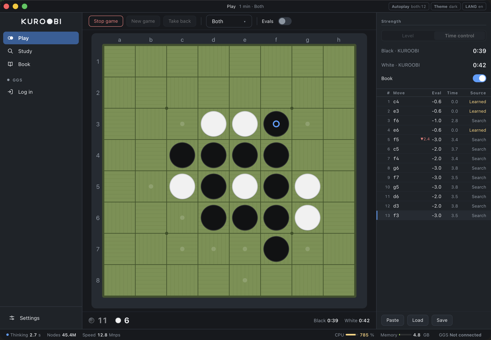
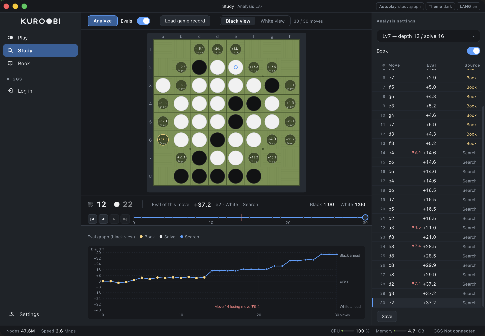
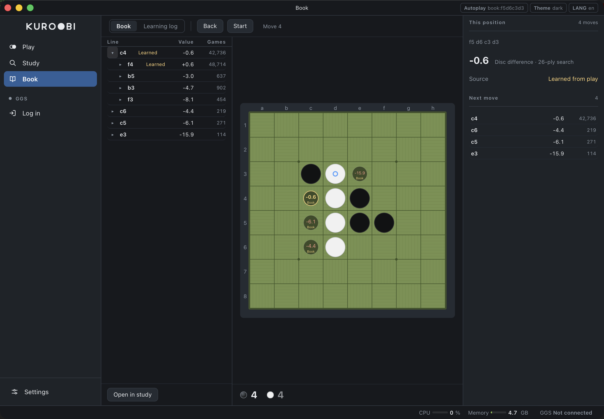
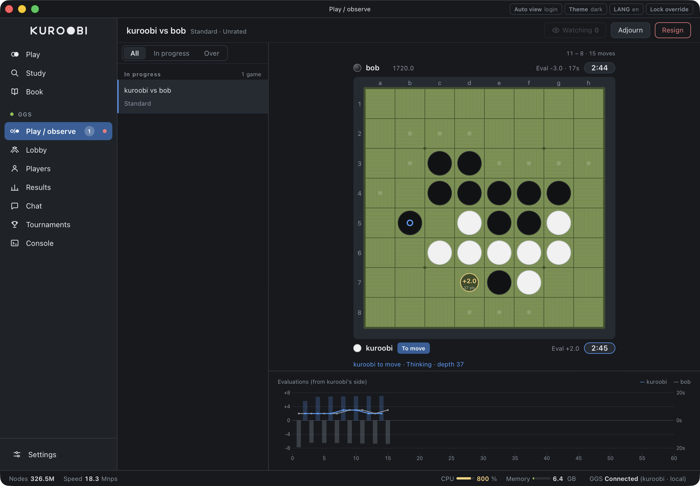

# GUI

The desktop app for play, study, the book and the GGS connection.

`gui/` is built with Tauri. The screen is web technology (React +
TypeScript, built with Vite), the thinking is the Rust side calling the
library directly, and IPC connects the two. The engine is not split off
into a separate process, so even a search in progress can report back
to the screen as it goes. The UI is in English or Japanese (Settings →
Display → Language). The build steps and the pitfalls are in
[CLAUDE.md](../CLAUDE.md).

## The window

The menu on the left is where you go: **Play, Study and Book**, then the
GGS section. Before connecting it holds only **Log in**; once connected
it holds **Play / observe, Lobby, Players, Results, Chat, Tournaments
and Console**. **Settings** (⌘,) sits at the bottom. Badges on the menu
show what needs attention: requests sent to you (Lobby), games in
progress with a dot when it is your move (Play / observe), unread
messages (Chat), and a tournament you have joined (Tournaments).

The status bar at the bottom is the same on every screen. On the left is
whatever is running — Auto match, Analyzing, Thinking, Learning, the
node count and the speed of the current search — and on the right CPU,
memory and the GGS connection. Pressing the GGS connection opens the
account menu (switch account, log in with another account, log out).

Details of a row picked in a list (a player, a finished game) open in a
drawer from the right; a click outside, × or Esc closes it. Errors and
notices appear as toasts at the bottom right. In any list, ↑ ↓ move to
the next row after a row has been clicked.

As the window narrows, the right-hand panel folds first (a panel button
appears in the toolbar to bring it back over the board), then the menu
shrinks to icons, then the auxiliary information in the toolbar goes;
the board is the last thing left. In a short window Study hides its eval
graph behind a Graph button.

## Play



*Play. Controls above the board, disc counts and clocks below. The right
panel holds the strength on top and the game record below; the record
carries the evaluation, thinking time and source of every move, and
poor moves get a ▼ with how much they lost. The node count and speed are
in the status bar at the bottom.*

Choose which side KUROOBI plays with **KUROOBI plays** (Black, White,
Both, None) and press **Start game**, or simply play your move on the
board, which starts the game. On KUROOBI's turn the board takes no
move. With None both sides are human; with Both KUROOBI plays itself. **Stop game**
pauses. **Evals** shows the evaluation of every legal move on the board
while you play (off by default in Play, kept separately from Study).

The right panel's **Strength** chooses between:

- **Level** — a preset (`Lv1 — depth 1 / solve 2` … `Lv13 — depth 24 /
  solve 26`) or **Custom…** with its own depth and exact-solve depth. The
  level can be changed during a game.
- **Time control** — 1 to 30 minutes, or **Custom…** to the second
  (0:30 to 99:59, see below). KUROOBI plans each move from its
  remaining time (see [Search](search.md#search-on-a-clock-clockrs)), and
  you get the same clock. Once the game starts the two times left
  replace the choice.

The **Book** switch below decides whether book moves are played (on by
default; turn it off when research calls for the engine's own move).
From **Start game** on, and while the record has a move, Level / Time
control and the clock are fixed until **New game**.

The clock runs only while a game is being played (from Start game until
Stop game, the end, or a pause), and each move is charged to the side
that made it. When a side runs out, the game stops with "Black ran out
of time" / "White ran out of time". The times are kept per move, so a
take-back or a jump in the record puts them back; moves nobody timed (a
loaded record, moves played without a clock) count as both clocks full.

- **Take back** (⌘Z) returns to before your own last move, taking
  KUROOBI's replies and passes with it. With None it takes back one move
  at a time, with Both one move. If KUROOBI has only made the first move,
  nothing happens.
- **Clicking a move in the record** during a game pauses there. Playing a
  move on that position takes the game on from it (as a take-back), and
  KUROOBI answers.
- **Leaving Play** for another screen pauses the game and its clock;
  Start game continues from the same position.
- **New game** (⌘N) asks first when the board has a record, since Play
  and Study share one record ("Start a new game?").

A finished game is imported into the book when learning is on (see
[Learning the book from real games](#learning-the-book-from-real-games-not-repeating-the-same-loss)).
A local game cannot start during a GGS game.

## Study



*Study. Below the board is the strip that walks the moves (the losing
move carries a red mark), and below that the evaluation graph measured
across the game record. With Evals on, the squares of the board show the
evaluation of every legal move as well.*

Study shares the board and record with Play; KUROOBI never moves here.
The right panel's **Analysis settings** (level and book, kept separately
from Play's strength) decide how strongly positions are measured.

- **Analyze** scores every position of the record under identical
  conditions and draws the eval graph (legend Book / Solve / Search);
  the losing move gets a red mark on the strip and on the graph.
  **Stop analysis** stops it, keeping the points measured so far.
  Switching between a running analysis and a game asks first.
- **Evals** (on by default in Study) shows every legal move's value on
  the board.
- Walk the record with the strip below the board, the record in the
  right panel, a click on the graph, or the keys: ← → one move, with ⇧
  ten moves, with ⌘ to the first or last position.
- **Black view / White view** flips the board and the graph.
- Playing a move on the board that matches the record steps forward.
  Playing a different move asks first ("Play a different move?"), then
  drops the rest of the record and its analysis.

Analysis is held off during a GGS game.

## Game records

**Load game record** (Study's toolbar, ⌘O) and **Paste** / **Load** (the
record panel in Play) read a paste or a file. The format is **GGF**
(Generic Game Format), which GGS uses, so a game that does not start
from the initial position (a random opening) is reproduced along with
its starting position. A plain move list (`f5d6c3…`) and the form of one
board line plus a move list are accepted as well. Before loading, a
preview shows the number of moves and the final position. If the board
already holds a record, loading asks first ("Replace the record?"),
wherever the record comes from — a paste, a file, or **Open in study**
on another screen.

**Save** (⌘S) writes GGF by default; the extension decides the format
(`.ggf` for GGF, anything else for a move list). The move list drops the
colours, the result and the starting position, so GGF is the better
choice for handing a game to other software.

## Book



*Book. The values of the candidate moves appear on the board, the
branches in the indented tree. Moves learned from real games carry a gold
Learned mark.*

The **Book** tab (⌘B) walks the book from a position. The tree on the
left lists the branches with each move's value and the number of games
it was played in; clicking a row makes it the new root, and **Open in
study** takes the line into Study. On the board only book moves can be
pressed. The right panel shows **This position** (its value, depth and
**Source**: book.txt or Learned from play) and **Next move**. ← goes
back, ↑ to the start, → follows the best move. Without a book file the
screen says so and offers **Open settings**.

The **Learning log** tab lists every imported game (filter by All / Lost
games and by period). For the selected game it shows the move that lost
the most on a board, **Open in study** for that position, and **Updated
book entries** — each move whose value was rewritten (old → new, or
New). **Show in book** opens the position in the Book tab, and **Undo**
removes the game's import.

## Settings

Settings is a screen of its own; changes apply at once.

- **Engine** — the files the engine uses (NNUE weights, linear eval,
  book), each with **Choose…** and the load state, and **Reset to
  defaults** to forget the chosen locations. Without a choice,
  `weights/` is found by walking up. **Threads** (used by local games,
  study, learning and GGS games) and the midgame / endgame **hash table**
  sizes (from the next launch). **Learning**: the **Import finished
  games** switch, the counts of stored and learned positions, and **View
  learning log**.
- **Display** — theme, language, decimals of evaluations, and the board:
  coordinates, the grain of the tatami, the disc flip (None / Fast /
  Slow), orientation (Black at bottom / White at bottom / You at bottom,
  which applies to GGS games too) and the mat color.
- **GGS** — Servers and accounts, Playing and watching, Request rules
  (see [GGS settings](#ggs-settings)).

The settings are kept in the OS config directory.

## Keys

⌘N new game, ⌘Z take back, ⌘S save, ⌘O load (these four in Play and
Study only; elsewhere ⌘Z stays the text field's undo), ⌘B book, ⌘,
settings. In Study ← → move one move (⇧ ten, ⌘ to the end); in the Book
tab ← back, ↑ start, → best move. No shortcut acts while a dialog is
open or a text field has the focus.

## Learning the book from real games (not repeating the same loss)

In back-to-back games against the same opponent, two deterministic
engines easily repeat the same game record. Inside the book the choice
is spread by a randomised pick with a tolerance (a draw among the moves
within 1 disc of the best, weighted by how often each was played), but
that alone does not prevent a lost line from being played out again —
without a book the choice is completely deterministic, and the same loss
is repeated exactly.

So finished games are imported into the book **win or lose**
(`learn.rs`). Each position the game passed through is given the move
actually played and an evaluation of the best of the other legal moves
(the alternative), and the final disc difference (for a resigned game,
the search value at the end) is written back to the root with negamax.

- Since each position's value is the best of its candidates, the value
  of a loss only travels back through the stretch where the alternative
  was bad too, and **localises where a good alternative remains — at the
  losing move**. Even opening moves are never avoided as collateral, and
  following the same line, the randomised pick naturally veers to the
  alternative at the losing move
- Won games are imported too, so that a line which was only won because
  the opponent erred, where the alternative was better, is not kept
  believed good
- There is no special logic for avoidance. "Not repeating the same loss"
  is a property of the negamax values, not a mechanism that forbids
  moves

Both GGS games and games finished in Play are imported; a record that
was merely loaded, a game that does not start from the initial
position, and games on a server not marked Public are not. The one switch,
**Import finished games** under Settings → Engine, covers all of them
(on by default). The import advances one search at a time in the
background and yields to games in progress (the status bar shows
Learning). What is learned is saved in a file separate from the book
itself (`book_learn.txt`) and overlaid at startup, so it does not clash
while `bookgen` is updating the main file, and even where there is no
book file a "book of experience" grows from the positions real games
went through.

The Learning log follows each import all the way to **game → losing move
→ the moves that were rewritten (old→new)**. Write-back overwrites
values, so a single odd game changes the moves that follow — the details
are kept so it can be found, and **an import can be undone per game**.
Undoing restores the value of a move that was in the book already, and
removes, candidate and all, a move that was not.

---

## GGS (online play)

A client for GGS (Generic Game Server) is built in. On GGS KUROOBI always
plays to the clock. The board, the clocks and the players' rows are drawn
with the same parts as a local game. Players are shown by their login
names, the logged-in account included. The app posts OS notifications
when a game starts, on your turn, on a request, at the end of a game and
when the connection drops (it reconnects by itself after 10 seconds).

### Log in and accounts

**Log in** takes a server (**Add server…** adds one by `host:port`), a
login name and a password. An account that logs in successfully is saved
(the password stays on this Mac), and the login screen then lists the
saved accounts by server. Each server and login keeps its own history,
chat and wire log, so switching accounts or using a test server never
mixes records. The account menu in the status bar switches between saved
accounts. Settings → GGS → Servers and accounts manages servers (Public
or Test), accounts and **Log in at start**.

### Play / observe



*Play / observe. A standard game in progress: both clocks, KUROOBI
thinking with its eval on the board, and the evals and thinking times of
both players under it.*

The list on the left holds your games and the games you observe (All / In
progress / Over), newest first; a synchro pair is one row. Finished
games can be removed from the list one by one or all at once.

The game shows one board, or the two boards of a synchro pair side by
side. Each board has the players' rows (rating, last reported eval and
time, the turn and the clock) and a status line: thinking with the depth,
solving, or the analysis of an observed game. Under the boards sits one
eval graph in the same place either way, from the side of the player
named in its title. For a synchro pair it plots the two boards' evals at
the same move number added together: the colours are swapped, so the sum
stays near 0, and a swing shows which board moved the match; a gold mark
shows the move where the two games split. Think time shares the frame as
faint bars from the 0 line, one player's up and the other's down.
Hovering shows both players' evals and times for that move.

The toolbar holds **Watching** with the number of spectators (pressing it
lists them; a name opens that player), **Adjourn** and **Resign** for
your own game (both ask first; tournament games cannot be adjourned),
**Stop observing** for an observed game, and **Record** once the game is
over. With no game, the screen offers what can start one: resuming an
adjourned game, requests waiting in the lobby, or **Ask for a game**.

**Record** (and the finished games on Players and Results) opens the
game viewer: replay with autoplay, **Board 1 / Board 2** for a synchro
pair, **Copy game record**, **Save to file**, and **Open in study**.

### Lobby

- **Ask for a game** opens the request sheet; **Accept requests** turns
  incoming requests on or off (saved, and sent to the server).
- **Waiting for you** — adjourned games (**Resume**), requests to you
  (**Decline** / **Accept**) and your own requests (**Withdraw**).
  Press **Refresh** to bring the adjourned list up to date before
  resuming.
- **In progress** — the games being played on the server, with
  **Observe** / **Stop observing**. Observing opens the game on Play /
  observe.
- **Open requests** — requests without a named opponent, with
  **Accept**.

### Asking for a game and auto match

The request sheet sets the **Opponent** (a dropdown of everyone online,
searchable, showing who accepts requests and who is playing; **Anyone**
makes an open request), the **Format** (synchro random 14–20, synchro
standard, standard, random 16), the **Time control** and **Rated**.
The time control is a main time and an extension together, as
tournaments set them: 1 or 3 minutes with 30 seconds (the recent
tournaments), 5, 10 or 15 minutes with 2 minutes (GGS's own extension,
left out of the request), or **Custom…**, which shows a field for each. It remembers the last choices. There is no increment:
KUROOBI's time plan only sees the time left, so an increment would go
unused.

A custom clock is one `mm:ss` field typed from the minutes: each part
shows its digits right-aligned as they come (`1` is 01:00), two minute
digits or `:` move to the seconds, Backspace takes back the last digit
and steps back into the minutes, and a seconds digit that would make 60
or more is refused. Clicking a part, or moving onto it with the arrow
keys, selects it: the next digit replaces it, and neither part ever
holds more than two digits. The value is kept on Enter or leaving the
field, pulled into range.

Picking an opponent reads their finger, and the sheet judges the request
against their decline formula the way the server does (the formula is
theirs, so `m…` is them and `o…` is you), again whenever the format, time
or Rated changes. A request it would turn away cannot be sent: a card
lays out their formula as an outline of "any of" and "all of" groups,
each condition in words ("not synchro", "the main time under 3 min
20 s"), with the ones that hold marked and the rest folded away. Every
marked line of an "any of" group has to be cleared, one of an "all of"
group is enough. Values only
the server knows (`rnd`, `playing`) leave the decision to it.

**Games: Repeat (auto match)** asks again and again: after each game it
waits the given seconds and asks the same opponent, up to the given
number of games (0 keeps going until stopped), optionally also accepting
requests that arrive meanwhile. Auto match needs a named opponent, asks
only while that opponent is online, and stops with a notice when the
opponent turns the request down twice in a row. It checks the
opponent's decline formula before each ask as the sheet does and stops
without asking when the request breaks it, or at once if the server
still answers that the request does not fit. While it runs the status
bar shows Auto match; pressing it reopens the sheet to change or stop it.
The sheet also opens from Players (with the opponent filled in) and from
a result's **Rematch**.

### Players

Your own ratings (random opening and standard) sit on top, then the
players: **Online** (rating in both pools, whether they accept requests,
and whether they are playing, online or offline) or **Top** (the ranking
of either pool), with search by name and paging. A row opens the
player's drawer: **Summary** (ratings, **Ask for a game**, **Chat** and
the rating trend), **Game history** (each game opens in the viewer) and
**Profile** (what `finger` reports, including their accept / decline
conditions).

### Results

Your finished games and how the rating moved. Pick the pool (Random /
Standard / All) and the period. For one pool the rating history is drawn
with the rating, the change over the period, W / L / D, win rate,
average disc difference and best rating; All shows the two ratings
instead, since there is no rating across pools. Games from the server's
history are mixed in. A row opens the drawer with the opponent's rating,
format, time control, colour, date, the rating change, the eval graph of
the game when its record carries evals, **Open kifu** and **Rematch**.

### Chat

Public chat and one conversation per person (**New person** starts one
with anyone online). Unread messages are counted on the menu.
**Show a Japanese translation** and **Send translated into English**
translate in either direction. Each login appends its chat to
`chat/<login>.jsonl` in its data folder, and the latest 300 messages per
conversation are restored at startup. 5000 per conversation are kept; on
overflow the file is rewritten and packed down. An unreadable line (such
as a last line cut short by a crash mid-write) is discarded and the rest
is used.

### Tournaments

Tournaments run by GGS's `/td` are listed (live and open, then
finished). A tournament shows its rules and progress, and before the
start its entrants with **Join** / **Withdraw**. Once it runs, two
tabs share the space below. **Crosstable** lists the players in ranking
order against each other: each cell is the row player's points and
W-D-L against that opponent (a GGS round robin meets the same opponent
many times), tinted green or red by how lopsided it is, and pressing it
shows the games between the two. With many players the header row and
the five standing columns stay put while the cells scroll both ways.
**All games** steps through the pairings round by round, or picks one or
two players to list their games across all rounds, the first pick on the
left with the result from their side; your own games are found by
picking yourself (**Open board** for the one in progress is in the
toolbar). If auto match is on
while you are in a tournament, a band warns that other games will still
be accepted and offers to change it.

### Console

The raw traffic with the server (All / Sent / Received, search, follow
latest, copy, save, clear) and a command line with a list of common
commands (`tell /os who 8` and the like). The same traffic is always
written to `ggs_wire.log` in the account's data folder.

### GGS settings

- **Servers and accounts** — see [Log in and accounts](#log-in-and-accounts).
- **Playing and watching** — **Book** (use book moves in GGS games),
  **Play automatically on my turn**, **Analyze observed games too**, and
  **Search log channel** (see
  [Each move can be posted to a channel](#each-move-can-be-posted-to-a-channel)).
- **Request rules** — the **Auto-accept condition** and **Auto-decline
  condition**, edited as a tree of conditions or written as a formula
  directly. These live on the server and apply even while the app is
  closed, so they are sent only on **Apply**. The tree covers the whole
  GGS formula language: groups that must all or any hold, and their
  negations (`!( … )`); a variable against a number or another variable
  (`mt1 < ot1`); the calls `md(x)` / `od(x)` (rating change if the game
  ends `x`), `rnd(n)` and `playing(T|F)` with their argument; and, via
  **Write as a formula…**, a row of free arithmetic such as `mr>or+100.0`.
  Formulas read the way the server does, with `&` and `|` on one level
  binding to the right, and are written back with every nested group
  bracketed, `==` for equality, `B`/`W`/`?` for colors and a `.0` on
  the REAL values (`mr`, `or`, `md`, `od`), which GGS otherwise rejects.
  A number GGS would refuse for its slot turns its field red and keeps
  **Apply** off. **Applied** shows only once `finger` carries the new
  formula; a formula the server refuses anyway (`dform ERR …`) is
  reported under the heading, and the previous one stays in force.
  **Use the defaults** under
  the decline condition fills in the tournament director's guidance
  (decline under 14 discs or under 1 minute of main time) together with
  everything KUROOBI cannot play or would play at a disadvantage:

  ```
  size!=8|anti|komi|mm1!=0|mt2!=0|mm3!=0|!ml1|discs<14|mt1<60
  ```

  That is other board sizes, anti and komi games, clocks with a move
  count or an increment, and a main time whose timeout is not a loss.

---

## What GGS taught us

Things that only surfaced once we ran on the real server, and the
policies decided by reading the server implementation
(`GGS/Service/GameLib`).

### An adjourned game is not resumed automatically

If the opponent leaves during a game, GGS stores it as **adjourned**
(`Match.C::cb_adjourn`). The clocks stop at that point and there is no
deadline (`GAME_Stored.H` has no notion of expiry). If the side that is
losing leaves, analyses and then resumes, **the server does not hold it
against them**.

Resuming automatically from our side would hand the opponent a way to
think for as long as they like and then come back, so **resuming is
manual only**. Adjourned games stay under Waiting for you in the lobby,
and one can be resumed after refreshing the list.

### Lost time cannot be told from how much time is left

GGS has only one clock. When the main time runs out, the server adds the
extension **to that same clock** and sends it (`now += ext` in
`GAME_Clock.C::update`). Overrunning by 30 seconds from 50 seconds left
simply delivers a healthy-looking `01:30`; the screen cannot tell the
difference.

And **entering it already decides the loss**. `Game::blacks_result` caps
the result of whichever side flagged first at `min(the board, a
minimum-margin loss)`, so being ahead on the board still does not make
it a win. The extension is time for avoiding a shutout (a 64-disc loss)
and nothing else; running that out too makes it a maximum-margin loss.

So the engine decides it is in lost time from "the clock went up": any
rise beyond the increment that lands within the extension counts, even
a small one from plenty of time left (from 50 seconds to 1:30 is only 40
seconds up). Once in it, the engine plays out without searching deep.

### Game records are fetched from the archive

For our own games only one board arrives (only an observer's join hands
over two, the start and the current one), so the live feed alone can
miss the starting position of a random opening. The server's archive
(`tell /os look <number>`) keeps the correct game record, down to **both
sides' evaluations and time spent**, so a game that has a number is
opened from there. A synchro match packs two boards into one number,
and the viewer switches between them.

### A synchro pair reports its margin twice, and one of them is the mean

The end of a match arrives on two kinds of line. `/os: end .N.B ( A vs.
B ) ±X` carries **that board's own margin**, once per board; the
`/os: - match` line that closes the pair carries **the mean of the two**.
Filling both boards from the `- match` line is the obvious thing to do
and it is wrong: every board then shows the same number and neither
shows its own. The per-board line fills the result, and the match line
only fills boards that have none of their own.

An adjourned game has no result of either kind. Rather than showing as
"a loss by 0", which is what an empty result renders as, it is marked
as adjourned.

### An update block carries only the latest move

`update` and `join` hand over the move that was just played, not the
whole record, so a block that is missed leaves a hole in the move map.
Anything built by walking the **keys** of that map — an evaluation
series, for instance — would drop that ply entirely and shift every
later point by one, and a chart spaced by position would end where the
holes begin.

So the series is built over `1..=last`, holes included, and the drawing
bridges the gaps. The axis then stays honest about where the game got
to.

### There are only two rating pools

Formats split into `s8r16` / `s8r14` / `8r16` and so on, but ratings
split only two ways: standard (`8`) and random opening (`8r`) (the Type
table in finger has two rows too). The Results screen filters by pool.
**There is no rating that runs across pools**, so All draws no history
line.

### The list shows who is accepting

`who` prints a mark after the name (`VAR_Client::print_who`). `+` means
they can accept (`open > number of games in progress`), `-` means they
will not, `x` is a ghost (the remains of a dropped connection). **Some
people will not accept even while idle**, so a match request comes up
empty if this cannot be read. Since people do accept while playing too,
it is a column of its own (Open), separate from the status.

### Each move can be posted to a channel

Spectators follow an engine by joining its channel, usually `.<login>`.
Setting **Search log channel** (Settings → GGS → Playing and watching)
joins it and posts each move there in the engine-log layout of the GGS
guide; left empty, nothing is joined or posted:

```
-----------------------------------------
kuroobi plays F5 in game .1.0 using 8 threads ;
score == +2 at 22@73% ; PV: F5 d6 C3 f4 ;
nodes: 2.149 GN ; time: search = 4.3s, move = 4.3s; speed: 499.8 MN/s.
search completed
```

Black's moves are in capitals and white's in lower case, `PA` being a
pass. `at` is `<depth>@<confidence>%` for a search (the confidence of
its ProbCut margin) and `<empties>@100%` for a solve. The PV is what the
tables still hold after the search, so it can end before eight moves.
`search` and `move` are the same time. The last line is `search out of
time at ...` when the deadline cut the search; book moves give only
`score == ... from book ;`. The channel must be a dot and 1-7 letters,
digits, `_` or `-` (GGS caps channel names at 8 characters); anything
else is refused rather than corrected. Our own lines come back to us and
are kept out of the chat.
